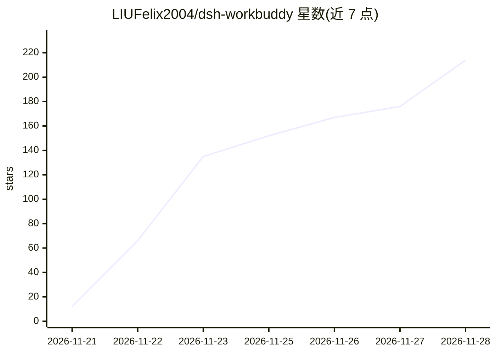

# LIUFelix2004/dsh-workbuddy

⭐ 214 · JavaScript · MIT · 推送 2026-11-21 · [GitHub](https://github.com/LIUFelix2004/dsh-workbuddy) · 个人维护 · 中文 README

**把 WorkBuddy 账号导入 DeepSeek Harness 作为模型 provider 的插件**

DeepSeek Harness 插件：将 WorkBuddy 账号接入为单一 provider，多账号组成账号池，请求轮询转发、失败冷却换号，模型目录读本机 WorkBuddy 产品配置，面板显示各账号积分余额。内置 fetch 守卫改写 system 文本与 User-Agent 以通过网关 11128 渠道校验，并支持叠加 dsh-purge 人格层。需要 DeepSeek Harness ≥0.2.1 与 Node.js ≥18；面向 WorkBuddy 国内版（copilot.tencent.com），国际版未适配。

## 筛选速览

| 维度 | 判定 | 备注 |
|---|---|---|
| AI 角色 | `ai-ecosystem` | LLM/agent 周边工具 |
| 许可风险 | `permissive` | MIT |
| 部署形态 | `None` |  |
| 模型依赖 | locked-api |  |
| 硬件要求 | — | 无带数字的原话,不猜 |
| 安装摩擦 | `low` | 无编译、无系统依赖或容器化 |
| 成熟度 | — | 结构信号不足 |

## 能力要点

- 多账号池：轮询转发、按 401/403/429/5xx 冷却并自动换号重试
- 模型目录读本机 WorkBuddy 配置，与客户端清单一致；无该文件退回内置 25 模型目录
- fetch 守卫改写 system 与 User-Agent 绕过网关 11128 校验，幂等且 fail-open
- 面板显示每账号积分余额、命中次数与冷却状态

## 适用场景

- 把 WorkBuddy 账号接入 DeepSeek Harness 后通过模型选择器调用
- 一次导入多个 WorkBuddy 账号合并额度并自动轮转
- 在 DSH 面板查看各账号积分余额与套餐明细

## 场景标签

`模型网关` · 领域:Agent 开发

## 证据(README 行号)

> L3: > 把 **WorkBuddy 账号**接进 **DeepSeek Harness**：**所有账号共用一家提供商**（`WorkBuddy`），模型是池内并集，请求按账号轮流转发；每个账号的积分余额单独显示，并自动绕过网关的 11
> L36: 要求：DeepSeek Harness `0.2.1` 或更高（web / desktop 均可），Node.js `>= 18`。

## 星数曲线

2026-11-21 12 → 2026-11-28 214（+202）

---
*卡片 v1 · prompt 1.4 · 生成 2026-11-27 · 置信度 high · 依据 README sha `832a21adbd49` · [字段定义](../../DATASET.md)*
