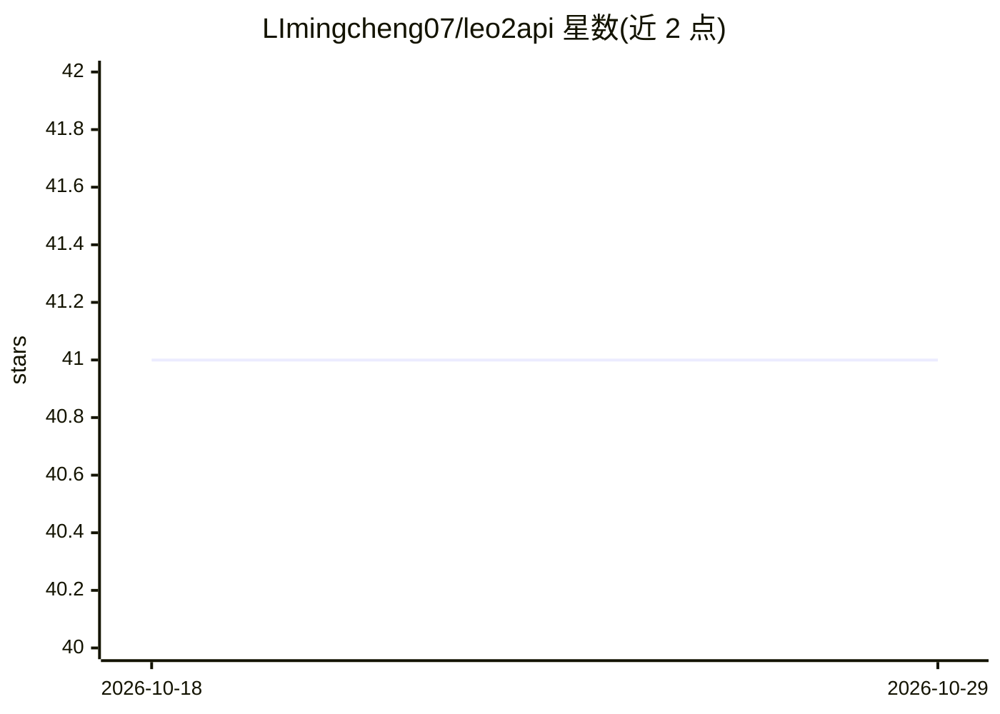

# LImingcheng07/leo2api

⭐ 41 · Go · MIT · 推送 2026-08-07 · [GitHub](https://github.com/LImingcheng07/leo2api) · 个人维护 · 中文 README

**Leonardo 视频生成的 OpenAI 风格 API 网关，含 Token 池调度**

用 Go 编写的反向代理网关：将多个 Leonardo 账号 Cookie 组织为 Token 池，对外暴露 OpenAI 风格的视频生成接口（POST /v1/video/generations），支持 Seedance 2.0 / Sora 2 / Kling O3 / MiniMax H3 等上游模型。机制包括 Token 轮换调度（round_robin/random）、JWT 到期前自动保活、积分门槛检测与额度耗尽自动清理、失败重试、远程素材自动上传。自带 Web 管理后台与 Cookie 批量导入 API。以 Go 单二进制或 Docker 部署，SQLite 默认存储（可选 Redis）。README 声明仅用于技术学习，账号合规性由使用者负责。

## 筛选速览

| 维度 | 判定 | 备注 |
|---|---|---|
| AI 角色 | `ai-ecosystem` | LLM/agent 周边工具 |
| 许可风险 | `permissive` | MIT |
| 部署形态 | `desktop` | 安装包/桌面程序 |
| 模型依赖 | — | README 未给出锁定关系 |
| 硬件要求 | — | 无带数字的原话,不猜 |
| 安装摩擦 | `low` | 无编译、无系统依赖或容器化 |
| 成熟度 | — | 结构信号不足 |

## 能力要点

- OpenAI 风格接口，SDK/curl 替换 Base URL 即可接入
- Token 池轮换调度 + JWT 自动保活 + 积分门槛跳过
- 图片/视频/音频远程素材自动下载上传，支持首尾帧
- Go 单二进制 / Docker 部署，SQLite 开箱即用

## 适用场景

- 把多个 Leonardo 账号整合为统一 API 供业务调用
- 在应用中通过 OpenAI 风格接口调用 Seedance/Sora 2/Kling/MiniMax 视频模型
- 管理 Token 池额度，自动跳过低积分与耗尽账号

## 场景标签

`视频生成` `模型网关` · 领域:Agent 开发

## 证据(README 行号)

> L3: > 把一堆 Leonardo 账号 Cookie 变成 **OpenAI 风格的一行 API**：视频生成反代 + Token 池自动调度 + JWT 自动保活 + 额度管理。
> L15: - ✅ **OpenAI 风格接口**：`POST /v1/video/generations` 一行接入，SDK/curl 直接替换 Base URL

## 星数曲线

2026-10-18 41 → 2026-10-29 41（+0）

---
*卡片 v1 · prompt 1.4 · 生成 2026-10-25 · 置信度 high · 依据 README sha `88c262b5245f` · [字段定义](../../DATASET.md)*
