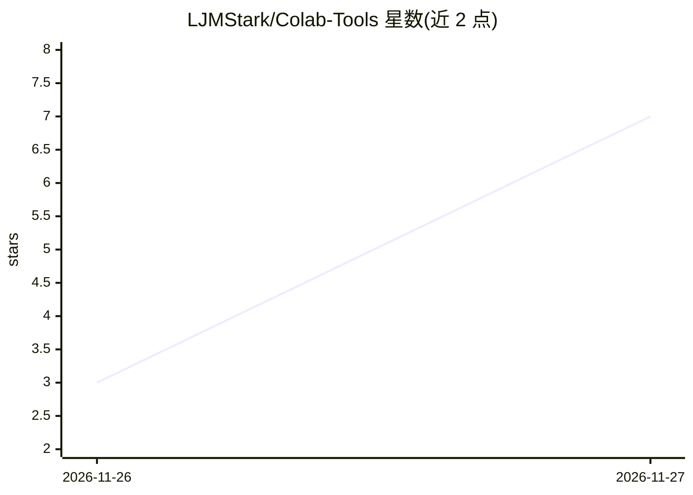

# LJMStark/Colab-Tools

⭐ 7 · Go · MIT · 推送 2026-11-26 · [GitHub](https://github.com/LJMStark/Colab-Tools) · 个人维护 · 中文 README

**给 Colab 用户一键部署 H3 视频模型并管理 GPU 账单的桌面工具**

基于 Go 的桌面控制台（macOS/Windows），面向通过 Google Colab 租用 GPU 的用户：一键将 H3 Original (31B)/H3 Flash (13.7B)/GGUF/自定义权重部署到 Colab VM，内置 ComfyUI，通过官方 google-colab-cli 执行启停与 SSH 隧道；监控 ComfyUI 队列与 GPU/CPU 负载，空闲后自动停止运行时以节省 Compute Units；支持 Drive 权重同步、错峰排队、以及切换为 LLM Proxy 配置写入 CC Switch/OpenCode/Codex CLI。Windows 依赖 WSL2 桥接。

## 筛选速览

| 维度 | 判定 | 备注 |
|---|---|---|
| AI 角色 | `ai-ecosystem` | LLM/agent 周边工具 |
| 许可风险 | `permissive` | MIT |
| 部署形态 | `desktop` | 安装包/桌面程序 |
| 模型依赖 | — | README 未给出锁定关系 |
| 硬件要求 | — | 无带数字的原话,不猜 |
| 安装摩擦 | `medium` | 含编译或系统依赖之一 |
| 成熟度 | — | 结构信号不足 |

## 能力要点

- 一键部署 H3 Original/Flash/GGUF/自定义权重，共享 21.5 GB 基座
- 监控队列与负载，空闲后自动停止并复核计费已停止
- 本地加密 SSH 隧道访问 ComfyUI（127.0.0.1:8188），无公开 URL
- 凭据存入 macOS Keychain/Windows Credential Manager 加密保管

## 适用场景

- 在 Colab 上跑 H3 视频生成，避免忘记关机烧掉算力点数
- 每次新 VM 免手动重装 ComfyUI 与上传脚本
- 用云端 GPU 给本地 Claude Code 等编码工具做 LLM 代理
- 在 Drive 保留已完成的视频输出，防断连丢失

## 场景标签

`模型网关` `视频生成` · 领域:Agent 开发

## 证据(README 行号)

> L5: **One-click H3 video model deployment, polite GPU queueing, and auto-shutdown money saver for Google Colab (macOS & 
> L7: No manual scripts or terminal juggling · Pick **H3 Original** or **H3 Flash** (or any custom weight) and click Start
> L49: Need a cloud GPU to power your local AI coding tools? Switch the recipe to **大模型代理 (LLM Proxy)** in the Deploy tab:

## 星数曲线

2026-11-26 3 → 2026-11-27 7（+4）

---
*卡片 v1 · prompt 1.4 · 生成 2026-11-26 · 置信度 high · 依据 README sha `d627660d2101` · [字段定义](../../DATASET.md)*
