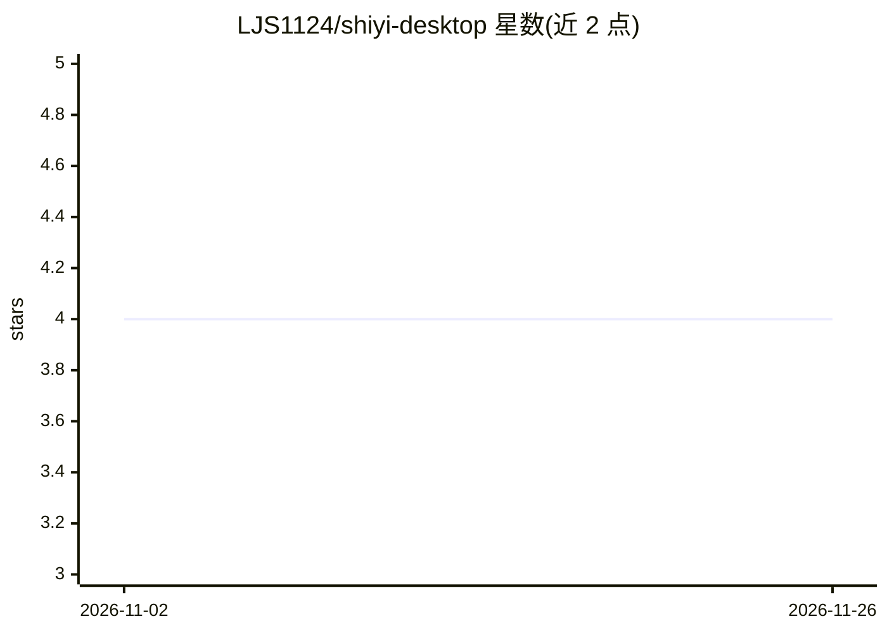

# LJS1124/shiyi-desktop

⭐ 4 · Rust · 推送 2026-10-30 · [GitHub](https://github.com/LJS1124/shiyi-desktop) · [官网](https://github.com/LJS1124/shiyi-desktop/releases/latest) · 个人维护 · 中文 README

**本地优先的灵感与项目管理桌面应用，AI 助手经命令行读写同一份数据**

Tauri 构建的 macOS/Windows 桌面应用，管理灵感、任务与项目，提供看板、日历、甘特图、PERT、燃尽图、思维导图六种视图和知识图谱。核心机制是界面与 `shiyi` 命令行共用一个 SQLite 文件：Claude Code、Codex 等助手安装技能说明后即可通过 JSON 命令行读写，所有写入经权限校验并记录批次、可撤销。内置 AI 功能（拆解灵感、补全任务、估算工期等）需手动触发、先预览再写入，支持多家服务商 API Key 或本地 Ollama。

## 筛选速览

| 维度 | 判定 | 备注 |
|---|---|---|
| AI 角色 | `ai-enhanced` | 去掉 AI 部分产品仍成立 |
| 许可风险 | `none` | — |
| 部署形态 | `desktop` | 安装包/桌面程序 |
| 模型依赖 | local-ok | 支持本地模型 |
| 硬件要求 | — | 无带数字的原话,不猜 |
| 安装摩擦 | `low` | 无编译、无系统依赖或容器化 |
| 成熟度 | — | 结构信号不足 |

## 能力要点

- `shiyi` 命令行让外部 AI 助手与界面共用同一份数据，修改实时同步并可撤销
- AI 权限分级（只读/可写/完全），AI 建的关联须确认，删除均为软删除
- 一个项目六种视图，依赖、三点估算和关键路径跨视图连通
- 本地优先：数据在本机 SQLite，每日自动备份，不联网也能用

## 适用场景

- 随手记灵感并用标签、双链自动归类关联
- 用 AI 助手通过命令行查询和管理今日任务与项目
- 在本地管理项目排期并查看关键路径与燃尽进度

## 场景标签

`知识图谱` `知识库管理` · 领域:知识与检索

## 证据(README 行号)

> L13: 拾忆是一个 macOS 和 Windows 桌面应用，管理随手冒出来的想法、工作和生活里的项目，并把它们连成一张知识图谱。
> L15: **你和你的 AI 助手用的是同一份数据。** 界面给人用；`shiyi` 命令行给 AI 用，Claude Code、Codex 这类助手装上技能说明就会操作。AI 做的每一处修改都会实时出现在界面里，并记在「操作记录」中，可以
> L26: - **AI 原生，但由你掌控**：外部 AI 助手通过命令行读写；内置的 AI 功能只在你点按钮时运行，结果先预览、改完再写入。AI 建的关联必须等你确认才算数，每一批修改都可以撤销。

## 星数曲线

2026-11-02 4 → 2026-11-26 4（+0）

---
*卡片 v1 · prompt 1.4 · 生成 2026-11-21 · 置信度 mid · 依据 README sha `8f888233e8f7` · [字段定义](../../DATASET.md)*
