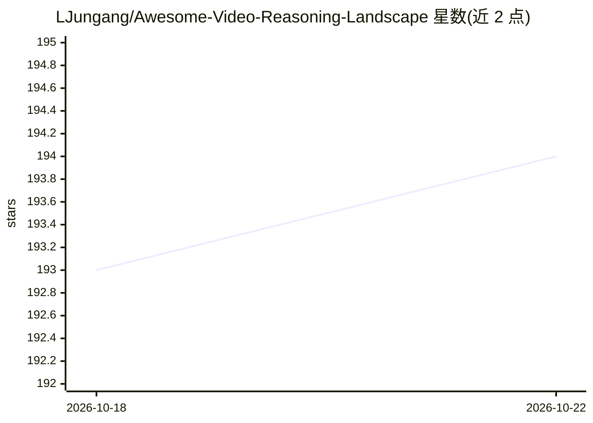

# LJungang/Awesome-Video-Reasoning-Landscape

⭐ 194 · Python · 推送 2026-09-29 · [GitHub](https://github.com/LJungang/Awesome-Video-Reasoning-Landscape) · 个人维护

**视频推理研究论文策展清单：任务、范式与基准的持续收录**

一个开源的 Awesome 类型论文清单，围绕视频推理（video reasoning）组织内容：按推理范式、Agentic 与交互式推理、感知与世界模型、基准评测等章节划分，收录带输入模态标注（文本/视频/音频/图像/深度/点云等）、发表时间与会议信息的论文条目，部分条目附代码、项目页、权重或数据集链接，并声明对收录内容做持续核验。面向从事视频理解与多模态推理研究的读者检索文献使用。

## 筛选速览

| 维度 | 判定 | 备注 |
|---|---|---|
| AI 角色 | `ai-knowledge` | 知识聚合/清单类 |
| 许可风险 | `none` | — |
| 部署形态 | `None` |  |
| 模型依赖 | — | README 未给出锁定关系 |
| 硬件要求 | — | 无带数字的原话,不猜 |
| 安装摩擦 | `low` | 无编译、无系统依赖或容器化 |
| 成熟度 | — | 结构信号不足 |

## 能力要点

- 按 4 个维度（推理发生位置/证据获取方式/支撑组件/评测）组织章节
- 论文条目标注 10 种输入模态徽章、首发热时间与会议
- 条目附代码、项目页、Hugging Face 权重/数据集等资源链接
- 声明持续核验收录内容，标注体例规则（如 (proc.)、N/A 含义）

## 适用场景

- 查找视频推理与长视频理解的最新论文
- 按输入模态或评测任务筛选相关研究
- 定位可复现工作的代码、权重与数据集

## 场景标签

`精选清单` `科研工具` · 领域:学习与行业

## 证据(README 行号)

> L7: A curated, continuously verified map of **reasoning over videos**, **reasoning through visual generation**, and **wo
> L25: ## 📚 Paper Atlas

## 星数曲线

2026-10-18 193 → 2026-10-22 194（+1）

---
*卡片 v1 · prompt 1.4 · 生成 2026-10-22 · 置信度 high · 依据 README sha `0363b5813143` · [字段定义](../../DATASET.md)*
