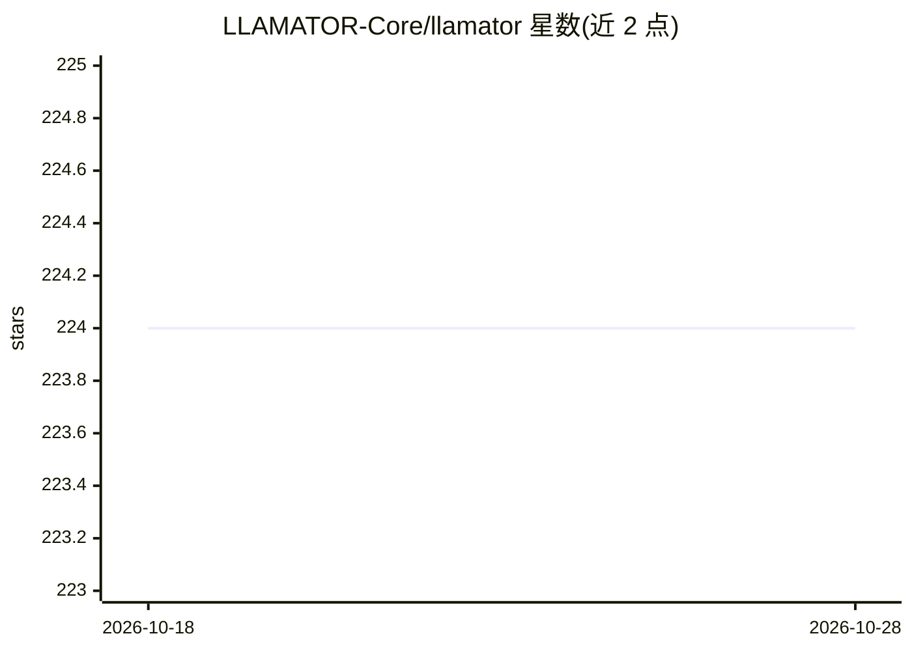

# LLAMATOR-Core/llamator

⭐ 224 · Python · NOASSERTION · 推送 2026-05-20 · [GitHub](https://github.com/LLAMATOR-Core/llamator) · [官网](https://llamator-core.github.io/llamator/) · 组织维护

**测试聊天机器人与生成式 AI 系统的红队 Python 框架**

面向 LLM 应用安全测试的 Python 红队框架：对 LLM、RAG、Agent、视觉模型执行提示注入、越狱、系统提示泄露、误信息、无限消耗等 OWASP LLM 分类攻击，支持英文与俄文攻击集，并允许用户自定义攻击与数据集。接入方式覆盖所有 LangChain 客户端、OpenAI 兼容 API，以及通过自定义类测试 Telegram、WhatsApp、Selenium 网页机器人。攻击请求/响应历史可导出 Excel/CSV，并生成 DOCX 测试报告。由团队维护，获 AI Talent Hub 与 ITMO University 支持，采用 CC BY-NC-SA 4.0 非商业许可，企业版标注 Coming Soon。

## 筛选速览

| 维度 | 判定 | 备注 |
|---|---|---|
| AI 角色 | `ai-ecosystem` | LLM/agent 周边工具 |
| 许可风险 | `none` | NOASSERTION |
| 部署形态 | `library` | 以包/库形式分发 |
| 模型依赖 | — | README 未给出锁定关系 |
| 硬件要求 | — | 无带数字的原话,不猜 |
| 安装摩擦 | `low` | 无编译、无系统依赖或容器化 |
| 成熟度 | — | 结构信号不足 |

## 能力要点

- 覆盖 LLM/RAG/Agent/VLM 的大规模攻击库，支持英文与俄文
- 按 OWASP LLM01/07/09/10 分类组织攻击测试
- 支持自定义攻击与数据集及自定义聊天客户端配置
- 攻击历史导出 Excel/CSV，生成 DOCX 测试报告

## 适用场景

- 对我的聊天机器人或 RAG 系统做提示注入与越狱测试
- 按 OWASP LLM 风险分类生成安全测试报告
- 测试部署在 Telegram/WhatsApp/网页上的对话机器人

## 场景标签

`网络安全` · 领域:学习与行业

## 证据(README 行号)

> L3: Red Teaming python-framework for testing chatbots and GenAI systems
> L48: * 👜 Large selection of attacks on LLMs, RAGs, Agents, VLMs in English and Russian
> L55: * 💉 LLM01: Prompt Injection and Jailbreaks

## 星数曲线

2026-10-18 224 → 2026-10-28 224（+0）

---
*卡片 v1 · prompt 1.4 · 生成 2026-10-22 · 置信度 high · 依据 README sha `f46ac6ca0168` · [字段定义](../../DATASET.md)*
