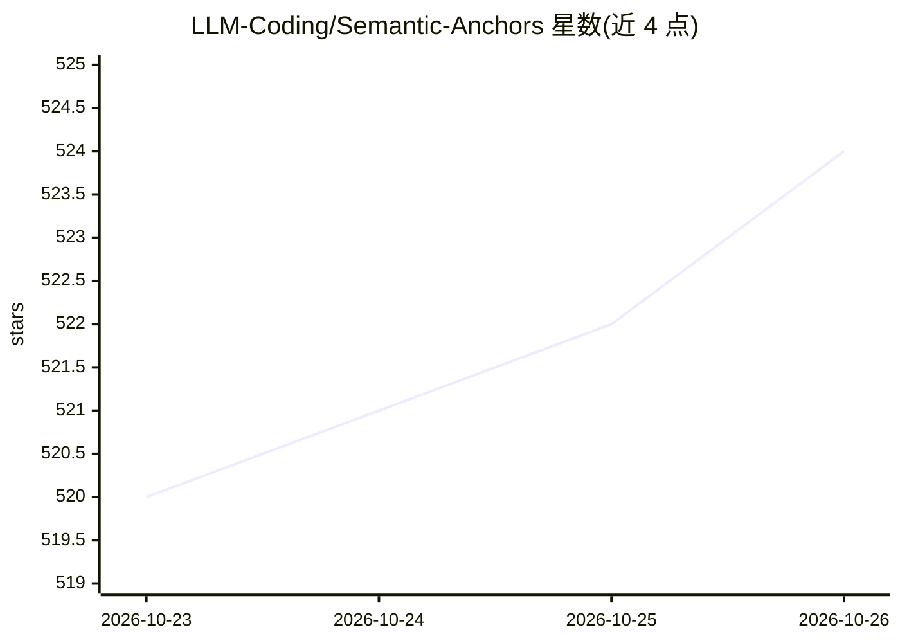

# LLM-Coding/Semantic-Anchors

⭐ 524 · HTML · Apache-2.0 · 推送 2026-10-25 · [GitHub](https://github.com/LLM-Coding/Semantic-Anchors) · [官网](https://llm-coding.github.io/Semantic-Anchors/) · 组织维护

**230+ 语义锚点策展清单：用术语激活 LLM 深层知识**

由 LLM Coding 社区维护的语义锚点目录：收录 arc42、TDD London School、tracer bullet 等 230+ 明确定义的术语与方法论，作为与 LLM 沟通时的共享词汇，替代在提示词中逐条展开方法描述。目录按 12 个 MECE 类别组织，支持按 18 种职业角色过滤，配有 Vite 构建的静态网站提供搜索与可视化。对本地/较小模型（Llama、Mistral、Phi 等）可将锚点定义注入 agent 指令文件，提供覆盖 Claude Code、Codex、Gemini CLI、Cursor、Copilot、Windsurf 的安装指南。贡献流程含 Anchor Prior Test 质量测试与 Copilot 辅助富化。

## 筛选速览

| 维度 | 判定 | 备注 |
|---|---|---|
| AI 角色 | `ai-knowledge` | 知识聚合/清单类 |
| 许可风险 | `permissive` | Apache-2.0 |
| 部署形态 | `library` | 以包/库形式分发 |
| 模型依赖 | — | README 未给出锁定关系 |
| 硬件要求 | — | 无带数字的原话,不猜 |
| 安装摩擦 | `low` | 无编译、无系统依赖或容器化 |
| 成熟度 | — | 结构信号不足 |

## 能力要点

- 230+ 语义锚点按 12 个类别组织，可按 18 种角色过滤
- 提供交互式网站：全文搜索、可视化、英德双语
- 针对本地/小模型提供将锚点定义注入 agent 指令文件的指南
- 贡献流程含质量测试（Anchor Prior Test）与 Copilot 辅助富化

## 适用场景

- 写提示词或 agent 指令时查找可用的术语锚点，减少 token 并保持一致性
- 为本地/较小 LLM 注入锚点定义以获得一致的方法论激活
- 按职业角色（架构师、QA、产品负责人等）浏览适用的锚点

## 场景标签

`提示工程` `精选清单` · 领域:Agent 开发

## 证据(README 行号)

> L16: Browse the full catalog of 230+ semantic anchors with interactive visualization, search, and role-based filtering:
> L22: *Semantic anchors* are well-defined terms, methodologies, and frameworks that serve as reference points when commun
> L36: Most frontier LLMs already recognize semantic anchors from their training data. However, if you use local or smalle

## 星数曲线

2026-10-23 520 → 2026-10-26 524（+4）

---
*卡片 v1 · prompt 1.4 · 生成 2026-10-22 · 置信度 high · 依据 README sha `fcf6eba36e76` · [字段定义](../../DATASET.md)*
