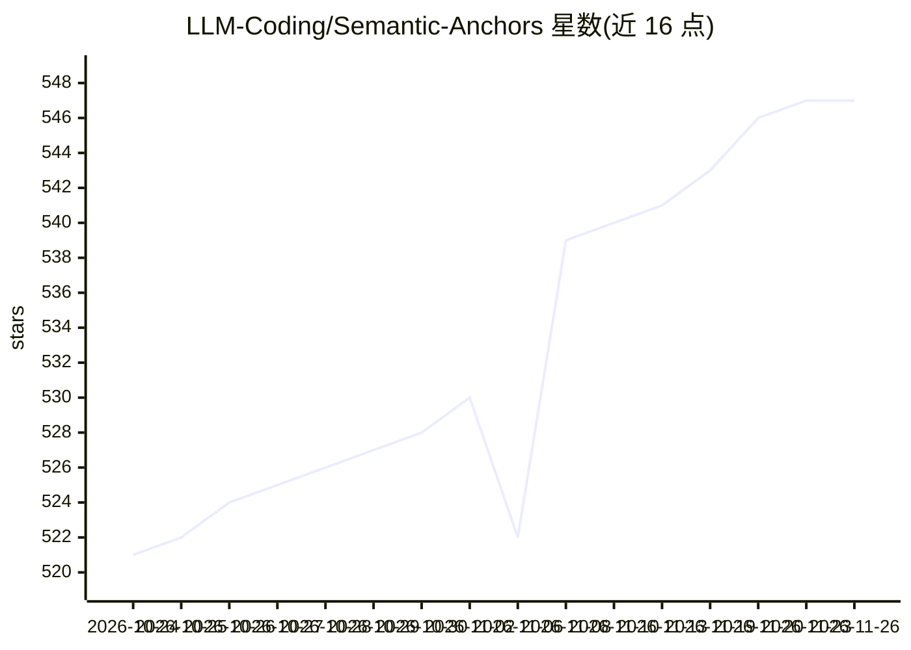

# LLM-Coding/Semantic-Anchors

⭐ 547 · JavaScript · Apache-2.0 · 推送 2026-11-24 · [GitHub](https://github.com/LLM-Coding/Semantic-Anchors) · [官网](https://llm-coding.github.io/Semantic-Anchors/)

**面向 LLM 使用者的 230+ 语义锚点术语编目清单**

该项目编目了 230+ 个语义锚点——即在提示词中引用即可激活 LLM 训练数据中对应方法论的既定术语（如 arc42、TDD London School）。条目按 15 个 MECE 类别组织，并支持按 18 种职业角色过滤，附交互式网站（搜索、卡片网格、英德双语）。收录遵循质量标准（精确、丰富、一致、可归因），社区通过 issue 模板提案，经 Anchor Prior Test 测试后由 Copilot 辅助生成条目并经维护者审核合并。本地/小模型可通过向 Claude Code、Codex 等工具的指令文件注入显式定义来使用。

## 筛选速览

| 维度 | 判定 | 备注 |
|---|---|---|
| AI 角色 | `ai-knowledge` | 知识聚合/清单类 |
| 许可风险 | `permissive` | Apache-2.0 |
| 部署形态 | `library` | 以包/库形式分发 |
| 模型依赖 | — | README 未给出锁定关系 |
| 硬件要求 | — | 无带数字的原话,不猜 |
| 安装摩擦 | `low` | 无编译、无系统依赖或容器化 |
| 成熟度 | — | 结构信号不足 |

## 能力要点

- 230+ 个经测试收录的语义锚点，按 15 个类别组织
- 按 18 种职业角色过滤锚点
- 配套 Vite 静态站点：全文搜索、卡片可视化、英德双语切换
- 本地模型场景提供向 agent 指令文件注入定义的安装指南

## 适用场景

- 写提示词时用简短术语替代冗长的方法论描述
- 为 Claude Code、Cursor 等编码 agent 配置共享术语定义
- 查找适合特定职业角色（架构师、QA、技术写作等）的提示词汇

## 场景标签

`提示工程` `精选清单` · 领域:Agent 开发

## 证据(README 行号)

> L22: *Semantic anchors* are well-defined terms, methodologies, and frameworks that serve as reference points when commun
> L63: The catalog is organized into 15 categories. Their scopes are MECE (Mutually Exclusive, Collectively Exhaustive); a
> L110: │ ├── anchors/ # Individual anchor files (230+)

## 星数曲线

2026-10-24 521 → 2026-11-26 547（+26）

---
*卡片 v1 · prompt 1.4 · 生成 2026-11-25 · 置信度 high · 依据 README sha `14828c7c97b3` · [字段定义](../../DATASET.md)*
