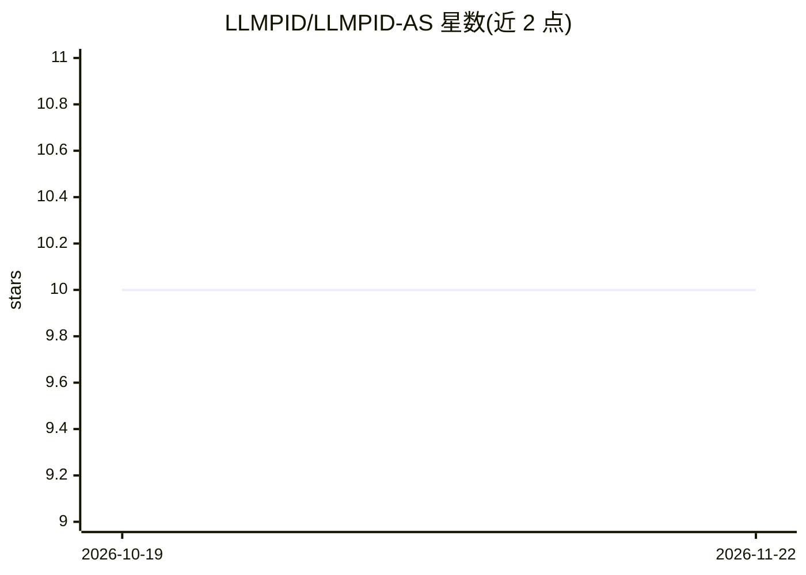

# LLMPID/LLMPID-AS

⭐ 10 · Go · AGPL-3.0 · 推送 2026-06-12 · [GitHub](https://github.com/LLMPID/LLMPID-AS) · 组织维护

**为 LLM 应用检测提示注入攻击的自托管 API 服务**

提供 HTTP API 的提示注入检测服务（PoC）：将待检 prompt 发送至 /api/classification，由微调 BERT 模型完成分类，返回检测结果并记录日志。架构为 Docker 封装的三个组件：Golang 主 API、Python 内部分类服务（加载 ONNX 模型）、监控用前端，使用 Traefik 路由和 Postgres 存储分类日志。提供基于角色（admin/ext_sys）的 JWT 认证、外部系统注册与会话管理。README 说明当前版本为 PoC，生产版本另在 warper.io 提供。

## 筛选速览

| 维度 | 判定 | 备注 |
|---|---|---|
| AI 角色 | `ai-native` | 本体是模型或模型工具 |
| 许可风险 | `viral` | AGPL-3.0 |
| 部署形态 | `self-host` | docker 或自建部署 |
| 模型依赖 | — | README 未给出锁定关系 |
| 硬件要求 | — | 无带数字的原话,不猜 |
| 安装摩擦 | `low` | 无编译、无系统依赖或容器化 |
| 成熟度 | `idea` | |

## 能力要点

- 基于微调 BERT（ONNX）模型的提示注入分类 API
- Docker Compose 一键部署，含 Go 主 API、Python 分类服务与监控前端
- admin/ext_sys 双角色 JWT 认证与外部系统注册、会话撤销机制
- Postgres 存储分类日志并提供分页查询接口

## 适用场景

- 给基于 LLM 的聊天机器人前置一层提示注入检测
- 内部部署检测服务并监控分类请求记录
- 为多个第三方系统注册独立访问凭证接入检测接口

## 场景标签

`网络安全` · 领域:学习与行业

## 证据(README 行号)

> L4: The project provides an HTTP API that allows other systems (or users) to detect prompt injections by sending a reque
> L271: ## Detect prompt injection

## 星数曲线

2026-10-19 10 → 2026-11-22 10（+0）

---
*卡片 v1 · prompt 1.4 · 生成 2026-11-20 · 置信度 high · 依据 README sha `7fcb896f16b0` · [字段定义](../../DATASET.md)*
