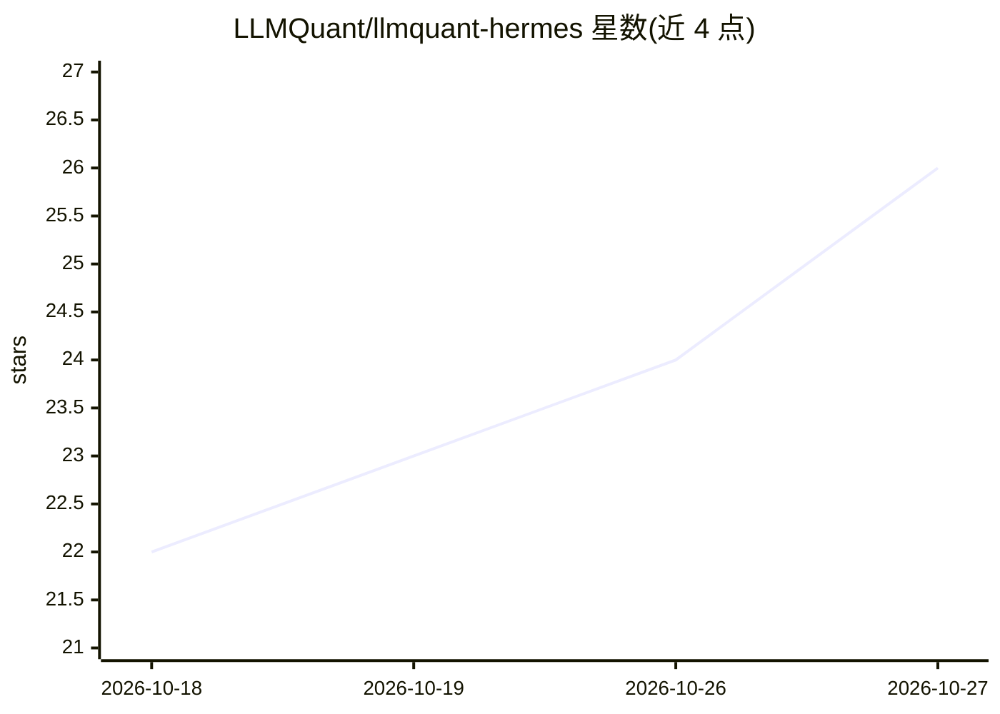

# LLMQuant/llmquant-hermes

⭐ 26 · MIT · 推送 2026-07-22 · [GitHub](https://github.com/LLMQuant/llmquant-hermes) · [官网](https://llmquantdata.com) · 组织维护 · 中文 README

**把 Hermes agent 配置成金融分析师的技能与部署套件**

面向 Hermes Agent（Nous Research）的胶水仓库：通过一段粘贴的指令或手动配置，为 agent 接入 LLMQuant Data 托管 MCP 服务，安装 5 个常驻看护剧本（晨报、财报提醒、13F 变动、持仓周检、Polymarket 观察）与 18 个 LLMQuant/skills 分析技能（股票、宏观、期权、预测市场等），并附带分析师人设与工作区模板。模型推理费用支付给所选后端（推荐 DeepSeek 基线），LLMQuant 积分在剧本调用数据工具时消耗，提供 Free Beta 计划。

## 筛选速览

| 维度 | 判定 | 备注 |
|---|---|---|
| AI 角色 | `ai-ecosystem` | LLM/agent 周边工具 |
| 许可风险 | `permissive` | MIT |
| 部署形态 | `None` |  |
| 模型依赖 | — | README 未给出锁定关系 |
| 硬件要求 | — | 无带数字的原话,不猜 |
| 安装摩擦 | `low` | 无编译、无系统依赖或容器化 |
| 成熟度 | — | 结构信号不足 |

## 能力要点

- 一段粘贴指令完成 MCP 连接、技能安装与冒烟测试
- 5 个常驻剧本 + 18 个分析技能（/llmquant-equities 等斜杠命令）
- 支持托管 Remote MCP URL 与本地 stdio 两种接入方式
- 附 SETUP.md 部署手册、分析师人设与工作区模板

## 适用场景

- 让 agent 每天早晨自动生成宏观与自选股晨报
- 跟踪关注基金经理的 13F 持仓变动并附新闻背景
- 用自然语言或斜杠命令按需做股票/宏观/预测市场分析

## 场景标签

`金融量化` · 领域:学习与行业

## 证据(README 行号)

> L145: Three layers, wired by one paste: **LLMQuant Data** is the tools (prices, filings, 13F holdings, macro, and compan
> L17: One paste gives your Hermes agent an analyst's full stack — market data, analysis method, and five standing watcher

## 星数曲线

2026-10-18 22 → 2026-10-27 26（+4）

---
*卡片 v1 · prompt 1.4 · 生成 2026-10-27 · 置信度 high · 依据 README sha `9f3dbc56fd6d` · [字段定义](../../DATASET.md)*
