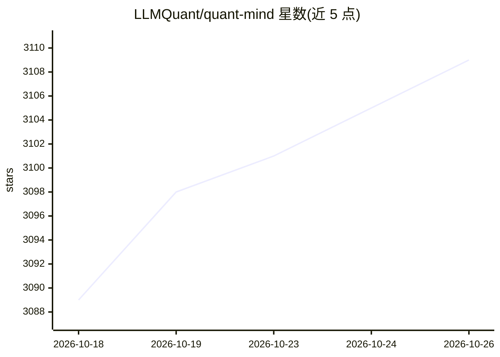

# LLMQuant/quant-mind

⭐ 3,109 · Python · MIT · 推送 2026-08-15 · [GitHub](https://github.com/LLMQuant/quant-mind) · [官网](http://llmquantdata.com/) · 组织维护

**量化金融知识抽取与检索框架，供 agent 构建流水线**

面向量化金融的开源 Python 框架：将论文、新闻、财报等原始信息经确定性预处理（fetch/parse/format/clean，无模型参与）精炼为带类型、引用与时间戳的结构化知识对象（Paper/News/Earnings/Factor/Thesis 等），并提供 chunking+BM25/相似度检索、本地持久化与 agentic 检索。支持配置驱动的 PaperFlow、collect_news、batch_run。仓库本身面向 coding agent 设计（AGENTS.md/CLAUDE.md 契约、contexts/、Claude+Codex hooks、verify.sh 确定性校验）。评测与更广数据源在 roadmap 中尚未交付；有 NeurIPS 2025 Workshop 论文（arXiv:2509.21507）。

## 筛选速览

| 维度 | 判定 | 备注 |
|---|---|---|
| AI 角色 | `ai-ecosystem` | LLM/agent 周边工具 |
| 许可风险 | `permissive` | MIT |
| 部署形态 | `library` | 以包/库形式分发 |
| 模型依赖 | locked-api |  |
| 硬件要求 | — | 无带数字的原话,不猜 |
| 安装摩擦 | `low` | 无编译、无系统依赖或容器化 |
| 成熟度 | `idea` | |

## 能力要点

- 确定性预处理产出可溯源、可复现的源忠实知识对象
- typed knowledge：Paper 结构树与 News/Earnings/Factor/Thesis 扁平卡片，自带 as_of 时间戳与来源引用
- rag/library/mind 三层检索，服务 RAG、Agentic RAG 与 data-MCP
- 仓库级 agent 契约与 Claude/Codex hooks，scripts/verify.sh 确定性校验

## 适用场景

- 把 arXiv 论文精炼为带页级引用的可检索结构化工件
- 收集新闻窗口并持久化为可时间查询的知识卡片
- 让 coding agent 在仓库内按契约搭建量化金融数据流水线

## 场景标签

`RAG` `金融量化` `科研工具` · 领域:知识与检索

## 证据(README 行号)

> L18: QuantMind is an information processor for quantitative finance: it refines raw financial information — papers, news
> L40: - **Retrieval over that knowledge** — `rag/` (chunking + BM25 / similarity), `library/` (local persistence + meanin

## 星数曲线

2026-10-18 3,089 → 2026-10-26 3,109（+20）

---
*卡片 v1 · prompt 1.4 · 生成 2026-10-20 · 置信度 mid · 依据 README sha `dc9de423a2f3` · [字段定义](../../DATASET.md)*
