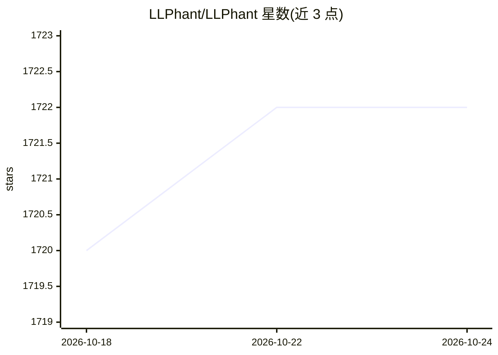

# LLPhant/LLPhant

⭐ 1,722 · PHP · MIT · 推送 2026-10-23 · [GitHub](https://github.com/LLPhant/LLPhant) · 组织维护

**PHP 生成式 AI 应用开发框架，接入多种 LLM 与向量数据库**

面向 PHP 开发者的生成式 AI 框架，兼容 Symfony 与 Laravel。提供构建 AI 应用的工具集，支持 OpenAI、Anthropic、Mistral、Ollama、LM Studio、Atlas Cloud 等多种 LLM 服务及 OpenAI API 兼容服务（如 LocalAI），可用 Ollama 本地运行 Llama 2。包含 JevClassifier 类型化分类功能（Noul/Choice/Score），可检测恶意提示注入，相关代码已抽取为独立库 Jev-PHP。通过 Composer 安装，要求 PHP 8.1+，主要客户端基于 OpenAI PHP SDK。

## 筛选速览

| 维度 | 判定 | 备注 |
|---|---|---|
| AI 角色 | `ai-ecosystem` | LLM/agent 周边工具 |
| 许可风险 | `permissive` | MIT |
| 部署形态 | `None` |  |
| 模型依赖 | local-ok | 支持本地模型 |
| 硬件要求 | — | 无带数字的原话,不猜 |
| 安装摩擦 | `low` | 无编译、无系统依赖或容器化 |
| 成熟度 | — | 结构信号不足 |

## 能力要点

- 支持 OpenAI、Anthropic、Mistral、Ollama、LM Studio 等多种 LLM 服务
- 兼容 Symfony 与 Laravel 框架
- JevClassifier 类型化分类与恶意提示注入检测
- 支持 OpenAI API 兼容服务（如 LocalAI）

## 适用场景

- 在 PHP/Laravel/Symfony 项目中接入 LLM 构建生成式 AI 应用
- 通过 Ollama 等本地运行 LLM 进行开发
- 对问答系统做提示注入检测

## 场景标签

`Agent 框架` `RAG` · 领域:Agent 开发

## 证据(README 行号)

> L1: # LLPhant - The PHP library for Gen AI and Vector Databases
> L5: We designed this framework to be as simple as possible, while still providing you with the tools you need to build p
> L8: We are working to expand the support of different LLMs. Right now, we are supporting OpenAI, Anthropic, Mistral, Oll

## 星数曲线

2026-10-18 1,720 → 2026-10-24 1,722（+2）

---
*卡片 v1 · prompt 1.4 · 生成 2026-10-21 · 置信度 high · 依据 README sha `4c694be9ba4b` · [字段定义](../../DATASET.md)*
