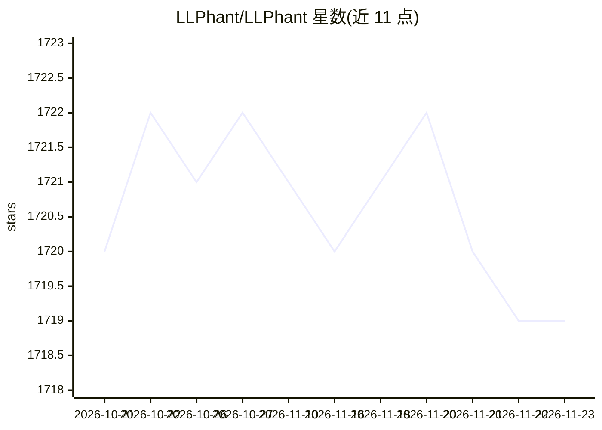

# LLPhant/LLPhant

⭐ 1,719 · PHP · MIT · 推送 2026-11-18 · [GitHub](https://github.com/LLPhant/LLPhant) · 组织维护

**PHP 生成式 AI 框架：构建 LLM 应用与向量检索**

面向 PHP 开发者的生成式 AI 框架，提供构建 LLM 应用的工具集，兼容 Symfony 与 Laravel。支持 OpenAI、Anthropic、Mistral、Ollama、LM Studio 及 OpenAI API 兼容服务等多种 LLM 接入，其中 Ollama 可本地运行 Llama 2 等模型。提供 JevClassifier 类型化分类能力，返回 token 用量元数据，并可用于检测提示注入。通过 Composer 安装，要求 PHP 8.1+，文档位于 docs 目录及在线站点。

## 筛选速览

| 维度 | 判定 | 备注 |
|---|---|---|
| AI 角色 | `ai-ecosystem` | LLM/agent 周边工具 |
| 许可风险 | `permissive` | MIT |
| 部署形态 | `None` |  |
| 模型依赖 | local-ok | 支持本地模型 |
| 硬件要求 | — | 无带数字的原话,不猜 |
| 安装摩擦 | `low` | 无编译、无系统依赖或容器化 |
| 成熟度 | — | 结构信号不足 |

## 能力要点

- 兼容 Symfony 与 Laravel 的 PHP 生成式 AI 框架
- 支持 OpenAI/Anthropic/Mistral/Ollama/LM Studio 等多种 LLM 接入
- JevClassifier 类型化分类并暴露 inputTokens/outputTokens 元数据
- ClassifierPromptInjectionQueryTransformer 检测恶意提示注入

## 适用场景

- 在 PHP/Symfony/Laravel 项目中接入 LLM 构建应用
- 使用 Ollama 在本地运行 Llama 2 等模型
- 构建基于向量数据库的检索应用
- 对问答结果做分类并检测提示注入

## 场景标签

`Agent 框架` `RAG` · 领域:Agent 开发

## 证据(README 行号)

> L1: # LLPhant - The PHP library for Gen AI and Vector Databases
> L10: We are working to expand the support of different LLMs. Right now, we are supporting OpenAI, Anthropic, Mistral, Ol
> L55: First, install LLPhant via the Composer package manager:

## 星数曲线

2026-10-21 1,720 → 2026-11-23 1,719（-1）

---
*卡片 v1 · prompt 1.4 · 生成 2026-11-23 · 置信度 high · 依据 README sha `0c522ebf34d0` · [字段定义](../../DATASET.md)*
