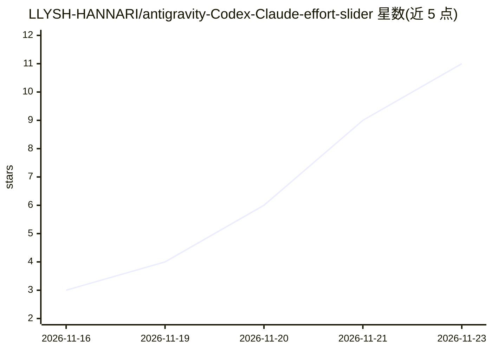

# LLYSH-HANNARI/antigravity-Codex-Claude-effort-slider

⭐ 11 · JavaScript · MIT · 推送 2026-11-22 · [GitHub](https://github.com/LLYSH-HANNARI/antigravity-Codex-Claude-effort-slider) · 个人维护 · 中文 README

**给 Antigravity 桌面端/IDE 注入 Codex&Claude 风格推理档位滑条**

一个第三方浏览器端/客户端注入插件，向 Antigravity 桌面端与 Antigravity IDE 的渲染进程注入推理等级滑条 UI，支持 Low/Medium/High 三档实时切换，并提供 Codex 与 Claude Code 两种视觉风格的物理动画渲染。安装方式为修补 resources/app.asar 与 main.js 或运行期 CDP 热注入；客户端更新会覆盖补丁需重装。项目面向 Antigravity 用户，README 含大量免责声明与风险提示，仅标注验证过特定客户端版本（桌面 2.32.1、IDE 2.7.0）。

## 筛选速览

| 维度 | 判定 | 备注 |
|---|---|---|
| AI 角色 | `ai-ecosystem` | LLM/agent 周边工具 |
| 许可风险 | `permissive` | MIT |
| 部署形态 | `None` |  |
| 模型依赖 | — | README 未给出锁定关系 |
| 硬件要求 | — | 无带数字的原话,不猜 |
| 安装摩擦 | `low` | 无编译、无系统依赖或容器化 |
| 成熟度 | — | 结构信号不足 |

## 能力要点

- 拖拽滑条跨档位边界即时调用 setModelConfigByLabelForConversation 切换推理档位
- 在模型选择菜单底部常驻滑条，切换模型时同步可用档位，单档位模型自动锁定
- 双风格渲染引擎：Codex 星尘滑块与 Claude 胶囊点阵扫掠波动画
- 支持持久补丁安装与零文件修改的 CDP 运行期热注入两种方式

## 适用场景

- 在 Antigravity 中快速切换模型的推理档位
- 为 Antigravity 客户端界面添加自定义滑条交互
- 本地开发中研究 Electron 应用 asar 修补与 CDP 注入

## 场景标签

 · 领域:开发者工具/客户端插件

## 证据(README 行号)

> L1: # Antigravity Codex&Claude风格推理等级滑条 (`antigravity-codex&Claude-effort-slider`)
> L74: - **`pointermove` 阶段穿透即切**：拖拽滑块途中一旦跨过档位边界，**在滑动事件阶段即刻同步调用 Antigravity 底层会话状态接口 `setModelConfigByLabelForConversatio
> L56: 1. **持久启动补丁**：自动备份并修补 Antigravity 桌面端 `resources/app.asar`（通过 `electron.webFrame.executeJavaScript` 将滑条注入渲染进程 Main 

## 星数曲线

2026-11-16 3 → 2026-11-23 11（+8）

---
*卡片 v1 · prompt 1.4 · 生成 2026-11-20 · 置信度 mid · 依据 README sha `681e3c45932d` · [字段定义](../../DATASET.md)*
