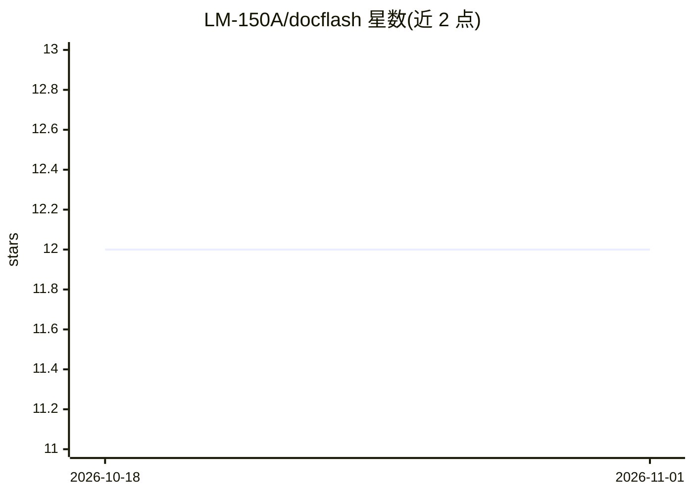

# LM-150A/docflash

⭐ 12 · HTML · Apache-2.0 · 推送 2025-12-08 · [GitHub](https://github.com/LM-150A/docflash) · 个人维护

**从文档抽取结构化数据的 Web 应用，支持反馈学习**

基于 FastAPI 的文档内容抽取 Web 应用：上传 PDF（OCR 转文本）或直接输入文本，按用户定义的 schema 抽取文本片段（Extract 模式）或生成解释性内容（Generate 模式），结果可导出为 HTML/JSON/JSONL。底层使用 Google LangExtract 与 Stanford DSPy 框架，用户对生成示例评分后 DSPy 自动优化提示词。支持 Azure OpenAI、OpenAI、Google Gemini、Ollama 四种提供商，需配置其一的 API 访问。需 Python 3.8+，从源码克隆安装运行。

## 筛选速览

| 维度 | 判定 | 备注 |
|---|---|---|
| AI 角色 | `ai-native` | 本体是模型或模型工具 |
| 许可风险 | `permissive` | Apache-2.0 |
| 部署形态 | `library` | 以包/库形式分发 |
| 模型依赖 | local-ok | 支持本地模型 |
| 硬件要求 | — | 无带数字的原话,不猜 |
| 安装摩擦 | `low` | 无编译、无系统依赖或容器化 |
| 成熟度 | — | 结构信号不足 |

## 能力要点

- Extract/Generate 双模式抽取，模板系统可保存复用配置
- 用户反馈驱动 DSPy 自动优化提示词（需 10+ 反馈示例）
- 支持 Azure OpenAI、OpenAI、Gemini、Ollama 四种提供商
- 结果导出 HTML/JSON/JSONL，抽取过程实时进度显示

## 适用场景

- 从合同、发票、表单中批量抽取指定字段
- 通过反馈标注逐步提升自家文档的抽取效果
- 复用模板在同类文档上重复执行抽取任务

## 场景标签

`文档解析` · 领域:知识与检索

## 证据(README 行号)

> L3: A web application for extracting structured data from documents with AI-powered intelligence and feedback learning. 
> L13: - **Extract Mode**: Find specific text spans from documents (names, dates, amounts)

## 星数曲线

2026-10-18 12 → 2026-11-01 12（+0）

---
*卡片 v1 · prompt 1.4 · 生成 2026-11-01 · 置信度 mid · 依据 README sha `50ee368a1f90` · [字段定义](../../DATASET.md)*
