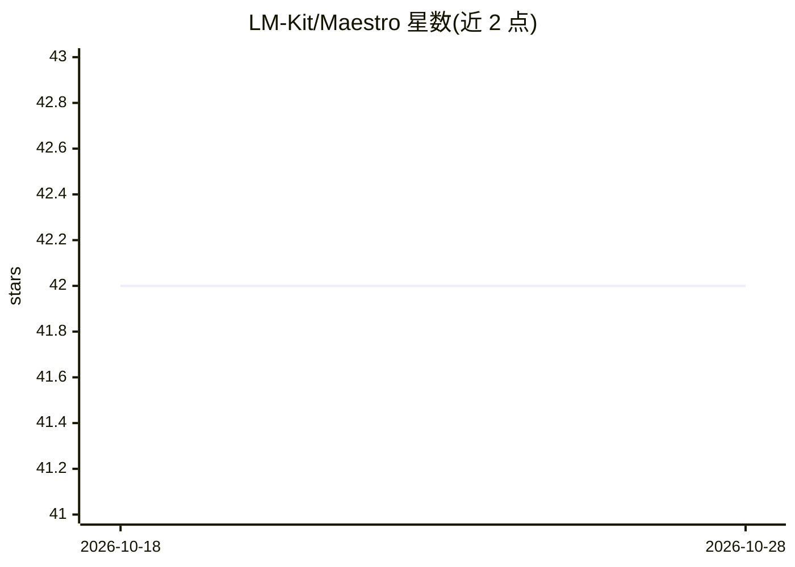

# LM-Kit/Maestro

⭐ 42 · C# · MIT · 推送 2026-02-10 · [GitHub](https://github.com/LM-Kit/Maestro) · [官网](https://lm-kit.com/) · 组织维护

**离线运行本地大模型的桌面 AI 助手/聊天 Agent 应用**

基于 .NET MAUI 与 Razor 构建的跨平台（Windows/macOS）桌面应用，底层使用 LM-Kit.NET 在本机离线运行大语言模型，无外部网络请求。提供对话式 Agent 创建、预置 Agent（文本纠错、翻译、语气调整）、模型性能评分、同一会话内切换模型、采样参数调节与响应重评再生成等功能。可从策划列表选模型或接入自定义模型；无 GPU 也可运行。RAG、视觉、音频等能力列为 Coming Soon。MIT 许可，个人与专业用途免费。

## 筛选速览

| 维度 | 判定 | 备注 |
|---|---|---|
| AI 角色 | `ai-native` | 本体是模型或模型工具 |
| 许可风险 | `permissive` | MIT |
| 部署形态 | `None` |  |
| 模型依赖 | — | README 未给出锁定关系 |
| 硬件要求 | — | 无带数字的原话,不猜 |
| 安装摩擦 | `low` | 无编译、无系统依赖或容器化 |
| 成熟度 | — | 结构信号不足 |

## 能力要点

- 完全离线在本地运行 LLM，无外部数据传输
- 基于 LM-Kit.NET 的 AI Agent 编排，可在同一会话中切换模型
- 按硬件容量给出模型性能评分
- 预置文本纠错、翻译、语气调整等 Agent

## 适用场景

- 在本机离线搭建个性化聊天机器人
- 数据不出本地的前提下使用大模型对话
- 对比多个本地模型的性能与输出质量

## 场景标签

`AI 助手` `聊天机器人` · 领域:对话与助手

## 证据(README 行号)

> L3: **Maestro** is a powerful desktop application that empowers you to orchestrate AI agents directly on your local mach
> L9: - **Offline Operation**

## 星数曲线

2026-10-18 42 → 2026-10-28 42（+0）

---
*卡片 v1 · prompt 1.4 · 生成 2026-10-25 · 置信度 high · 依据 README sha `1b914f6751b7` · [字段定义](../../DATASET.md)*
