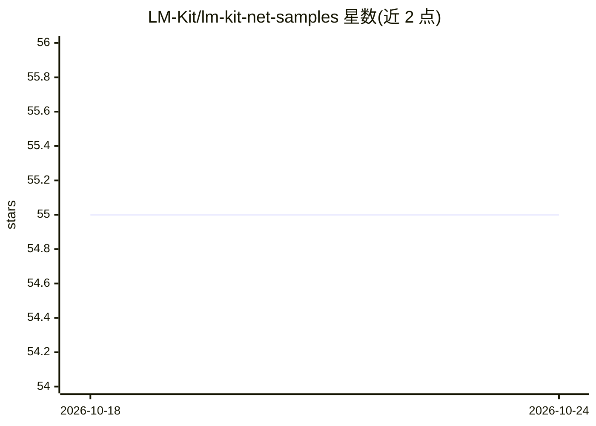

# LM-Kit/lm-kit-net-samples

⭐ 55 · C# · Apache-2.0 · 推送 2026-10-23 · [GitHub](https://github.com/LM-Kit/lm-kit-net-samples) · [官网](https://lm-kit.com/) · 组织维护

**LM-Kit.NET 私有 AI 运行时的 C# 可运行示例集**

LM-Kit 组织维护的 .NET 示例仓库，配套其商业库 LM-Kit.NET（进程内私有 AI 运行时）。示例覆盖 AI Agent、文档智能、视觉多模态、RAG、文本分析、语音转文字、本地推理、量化微调等 11 个能力方向。每个示例面向 .NET 8+，自动拉取 NuGet 包并在首次运行时下载模型，自动选择 CUDA/Vulkan/Metal/CPU 后端，无需 API key 与云调用。克隆仓库后 dotnet run 即可运行。

## 筛选速览

| 维度 | 判定 | 备注 |
|---|---|---|
| AI 角色 | `ai-ecosystem` | LLM/agent 周边工具 |
| 许可风险 | `permissive` | Apache-2.0 |
| 部署形态 | `None` |  |
| 模型依赖 | — | README 未给出锁定关系 |
| 硬件要求 | — | 无带数字的原话,不猜 |
| 安装摩擦 | `medium` | 含编译或系统依赖之一 |
| 成熟度 | — | 结构信号不足 |

## 能力要点

- 11 个能力方向的 C# 可运行示例（Agent、RAG、视觉、语音等）
- 进程内离线运行，无 API key、无云调用
- 自动选择 CUDA/Vulkan/Metal/CPU 后端，支持多 GPU 与 CPU+GPU 混合
- 首次运行自动拉取 NuGet 包并下载模型（缓存复用）

## 适用场景

- .NET 开发者学习如何在应用内嵌入本地 LLM 能力
- 评估 LM-Kit.NET 在自己硬件上的各能力表现
- 参考 Agent/RAG/文档智能等场景的实现代码

## 场景标签

`RAG` `多模态` · 领域:知识与检索

## 证据(README 行号)

> L3: Runnable C# examples for LM-Kit.NET, the Embedded Private AI Runtime for .NET: models, agents, RAG, search, document
> L5: Every sample runs offline, on your own hardware, with no API keys and no cloud calls. Clone, `dotnet run`, done.
> L36: - Pulls the LM-Kit.NET NuGet package automatically

## 星数曲线

2026-10-18 55 → 2026-10-24 55（+0）

---
*卡片 v1 · prompt 1.4 · 生成 2026-10-24 · 置信度 high · 依据 README sha `fdceb71a400d` · [字段定义](../../DATASET.md)*
