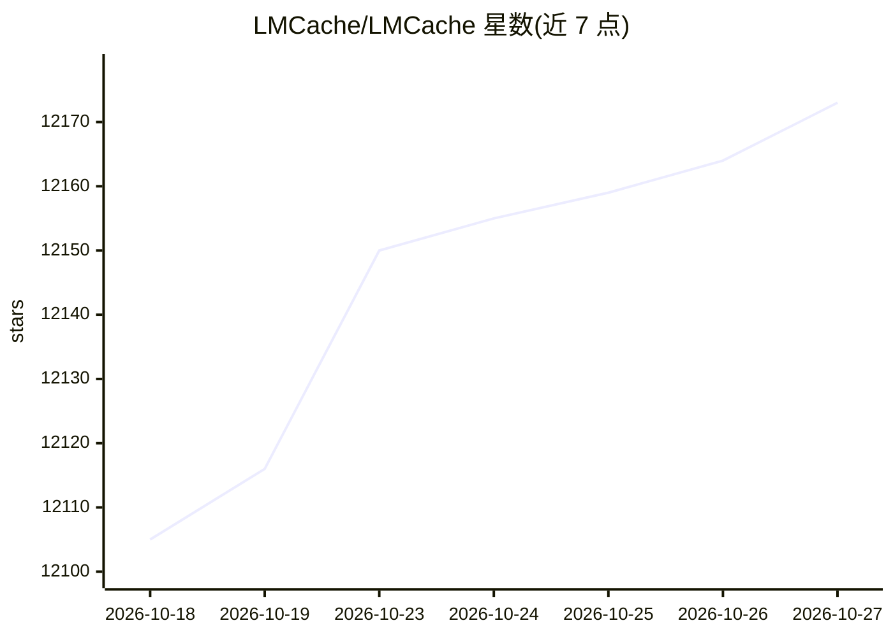

# LMCache/LMCache

⭐ 12,173 · Python · Apache-2.0 · 推送 2026-10-26 · [GitHub](https://github.com/LMCache/LMCache) · [官网](https://lmcache.ai/) · 组织维护

**LLM 推理的 KV 缓存管理层：跨引擎持久化存储与复用**

面向 LLM 推理服务的 KV cache 管理层，以独立守护进程方式运行，与推理引擎进程解耦。将 KV cache 从临时状态转为可持久存储、跨引擎复用、可监控的资源：支持分层卸载（GPU→CPU 内存/本地盘/Redis/S3 兼容对象存储/NIXL 等远程后端）、非前缀 KV 复用（CacheBlend）、PD 分离与 NVLink/RDMA/TCP KV 传输、可插拔 KV 变换接口，以降低 TTFT、提升吞吐。厂商中立，兼容多种开源推理引擎与硬件。以 pip 包提供，Apache 2.0 许可。

## 筛选速览

| 维度 | 判定 | 备注 |
|---|---|---|
| AI 角色 | `ai-ecosystem` | LLM/agent 周边工具 |
| 许可风险 | `permissive` | Apache-2.0 |
| 部署形态 | `library` | 以包/库形式分发 |
| 模型依赖 | local-ok | 支持本地模型 |
| 硬件要求 | — | 无带数字的原话,不猜 |
| 安装摩擦 | `low` | 无编译、无系统依赖或容器化 |
| 成熟度 | — | 结构信号不足 |

## 能力要点

- 引擎无关的独立守护进程部署，缓存不随引擎崩溃丢失
- 分层持久化卸载：CPU 内存、本地 SSD、Redis/Valkey、S3 兼容存储、NIXL 等
- 非前缀 KV 复用（CacheBlend 选择性重算）
- PD 分离场景经 NVLink/RDMA/TCP 传输 KV cache

## 适用场景

- 长上下文 agent 与多轮对话推理降低重复 prefill 开销
- 跨引擎、跨实例复用已存储的 KV cache
- RAG 等知识增强负载的 KV 缓存管理与观测

## 场景标签

`推理引擎` · 领域:训练与推理

## 证据(README 行号)

> L44: LMCache is a **KV cache management layer** for LLM inference. It turns KV cache from a temporary state into reusabl
> L46: LMCache is **vendor-neutral**. It can be used as a KV cache layer for a range of mainstream open-source serving eng
> L66: LMCache is becoming an integral layer in the LLM inference *ecosystem*, with *community*-driven integration with se

## 星数曲线

2026-10-18 12,105 → 2026-10-27 12,173（+68）

---
*卡片 v1 · prompt 1.4 · 生成 2026-10-20 · 置信度 high · 依据 README sha `118c3084cf00` · [字段定义](../../DATASET.md)*
