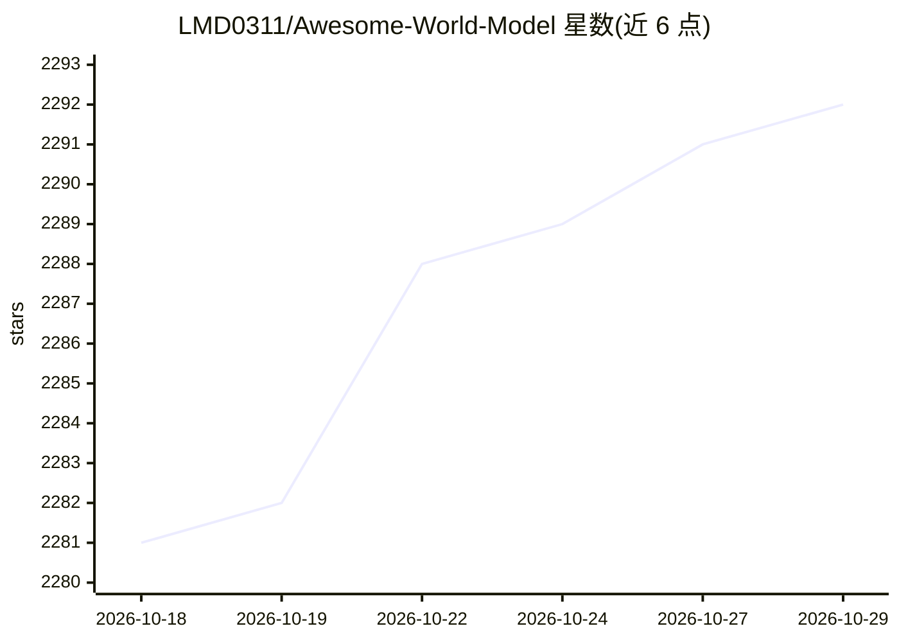

# LMD0311/Awesome-World-Model

⭐ 2,292 · 推送 2026-10-27 · [GitHub](https://github.com/LMD0311/Awesome-World-Model) · [官网](https://arxiv.org/abs/2502.10498) · 组织维护

**自动驾驶/机器人世界模型论文追踪清单，配合综述使用**

作为作者团队综述（The Role of World Models in Shaping Autonomous Driving）的补充资料，收录并按年份组织自动驾驶与机器人领域世界模型相关论文，含早期经典论文、技术博客与视频、多篇综述、2026 年最新论文条目，并附 CVPR 系列相关 Workshop 与 Challenge 信息。条目多带 Paper/Code/Project 链接，接受社区通过 PR 与 issue 补充。

## 筛选速览

| 维度 | 判定 | 备注 |
|---|---|---|
| AI 角色 | `ai-knowledge` | 知识聚合/清单类 |
| 许可风险 | `none` | — |
| 部署形态 | `None` |  |
| 模型依赖 | — | README 未给出锁定关系 |
| 硬件要求 | — | 无带数字的原话,不猜 |
| 安装摩擦 | `low` | 无编译、无系统依赖或容器化 |
| 成熟度 | — | 结构信号不足 |

## 能力要点

- 按年份与类别组织的世界模型论文条目，多数带 Paper/Code/Project 链接
- 收录 CVPR 23-25 相关 Workshop 与 Challenge 信息
- 作为 FCS 综述论文的补充，支持社区 PR/issue 补充条目

## 适用场景

- 查找自动驾驶/机器人世界模型的最新论文
- 了解世界模型相关的综述与研讨会脉络
- 作为综述论文的配套追踪清单使用

## 场景标签

`精选清单` · 领域:学习与行业

## 证据(README 行号)

> L5: This repo is used for recording, tracking, and benchmarking several recent World Models (for Autonomous Driving or R
> L43: ### Survey

## 星数曲线

2026-10-18 2,281 → 2026-10-29 2,292（+11）

---
*卡片 v1 · prompt 1.4 · 生成 2026-10-21 · 置信度 high · 依据 README sha `40e19b9c59cc` · [字段定义](../../DATASET.md)*
