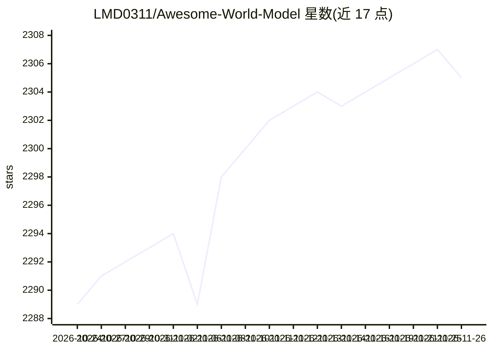

# LMD0311/Awesome-World-Model

⭐ 2,305 · 推送 2026-11-21 · [GitHub](https://github.com/LMD0311/Awesome-World-Model) · [官网](https://arxiv.org/abs/2502.10498) · 组织维护

**自动驾驶（及机器人）世界模型论文策展清单**

作为一篇世界模型综述论文的配套仓库，用于记录、跟踪和基准测试近年自动驾驶与机器人领域的世界模型方法。内容按类别组织：Workshop & Challenge 信息、世界模型原始论文、技术博客与视频、综述论文列表，以及按年份分组的论文条目（附 Paper/Code/Project 链接）。维护者欢迎通过 pull request 或 issue 补充被遗漏的论文。

## 筛选速览

| 维度 | 判定 | 备注 |
|---|---|---|
| AI 角色 | `ai-knowledge` | 知识聚合/清单类 |
| 许可风险 | `none` | — |
| 部署形态 | `None` |  |
| 模型依赖 | — | README 未给出锁定关系 |
| 硬件要求 | — | 无带数字的原话,不猜 |
| 安装摩擦 | `low` | 无编译、无系统依赖或容器化 |
| 成熟度 | — | 结构信号不足 |

## 能力要点

- 配套综述论文《The Role of World Models in Shaping Autonomous Driving》的论文清单
- 收录自动驾驶/机器人世界模型论文并附 Paper/Code/Project 链接
- 收录 CVPR 等相关 Workshop & Challenge 信息
- 接受社区通过 PR/issue 补充条目

## 适用场景

- 检索自动驾驶世界模型方向的论文与代码
- 跟踪该领域综述与 workshop 动态
- 为相关研究寻找引用与调研起点

## 场景标签

`精选清单` · 领域:学习与行业

## 证据(README 行号)

> L5: This repo is used for recording, tracking, and benchmarking several recent World Models (for Autonomous Driving or R
> L29: ## Papers

## 星数曲线

2026-10-24 2,289 → 2026-11-26 2,305（+16）

---
*卡片 v1 · prompt 1.4 · 生成 2026-11-23 · 置信度 high · 依据 README sha `36be0e5628fd` · [字段定义](../../DATASET.md)*
