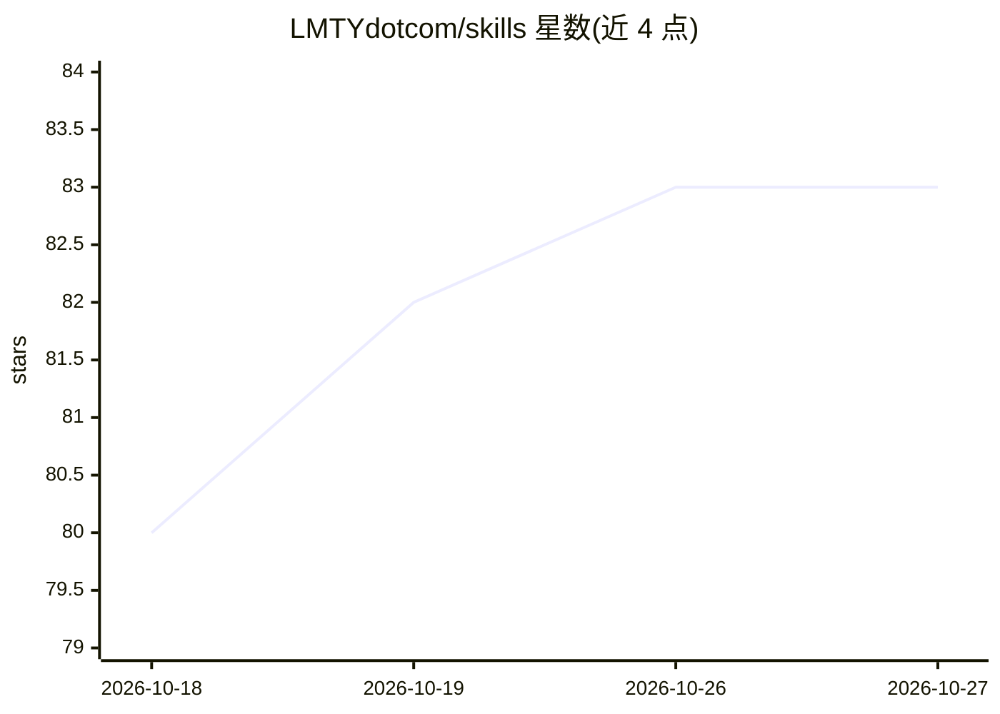

# LMTYdotcom/skills

⭐ 83 · Python · MIT · 推送 2026-10-02 · [GitHub](https://github.com/LMTYdotcom/skills) · [官网](https://lmty.com) · 组织维护

**面向 GTM 竞争情报工作的 AI Agent 技能包，装入各类助手使用**

由 LMTY 维护的 Agent Skills/Plugin 技能包，覆盖竞争简报、深度调研、定位与信息审计、定价评审、发布准备、battlecard、异议应对、商机准备与赢单分析等 16 项竞争性 GTM 任务。技能可安装到 Claude Code、Codex、ChatGPT、GitHub Copilot、Cursor、Gemini CLI 及任意支持 Agent Skills 的客户端，助手按请求自动选择技能；每个技能可独立运行。可选连接 LMTY 服务（MCP，内置配置）：连接后基于已跟踪竞争对手与带日期的证据工作，未连接则每次从零调研并声明为快照。技能行为遵循明确规则：未观察不等于不存在、事实与解释分离、断言附带观察日期。MIT 许可，发布包签名。

## 筛选速览

| 维度 | 判定 | 备注 |
|---|---|---|
| AI 角色 | `ai-knowledge` | 知识聚合/清单类 |
| 许可风险 | `permissive` | MIT |
| 部署形态 | `desktop` | 安装包/桌面程序 |
| 模型依赖 | — | README 未给出锁定关系 |
| 硬件要求 | — | 无带数字的原话,不猜 |
| 安装摩擦 | `low` | 无编译、无系统依赖或容器化 |
| 成熟度 | — | 结构信号不足 |

## 能力要点

- 16 项竞争情报技能，覆盖简报/定位/定价/battlecard/赢单分析等
- 支持 Claude Code、Codex、ChatGPT、Copilot、Cursor、Gemini CLI 及通用 Agent Skills 客户端
- 可选连接 LMTY MCP 服务器获取持续跟踪的竞争数据与带日期的证据链
- 技能行为规范：未观察≠不存在、事实与解释分离、断言携带日期

## 适用场景

- 让 AI 助手每周自动产出竞争简报
- 销售在通话前快速生成对特定竞品的 battlecard 与异议应对
- 审计自家定价/文案/资料在竞品变化后是否过时
- 复盘赢单输单并归纳买家实际反馈

## 场景标签

`AI 写作` · 领域:内容生成

## 证据(README 行号)

> L14: Add the pack once, then ask in plain English, "Give me this week's
> L16: a repeatable method for completing the work. The skills work in Claude Code,
> L27: |Skill|Ask something like|You get|

## 星数曲线

2026-10-18 80 → 2026-10-27 83（+3）

---
*卡片 v1 · prompt 1.4 · 生成 2026-10-24 · 置信度 mid · 依据 README sha `218267525bb9` · [字段定义](../../DATASET.md)*
