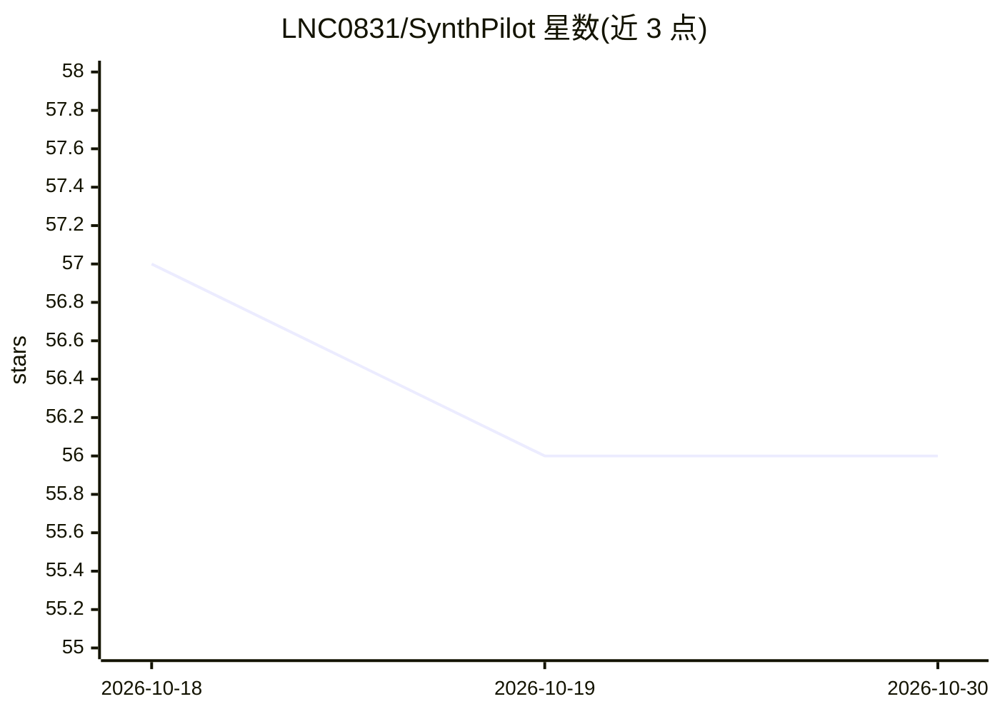

# LNC0831/SynthPilot

⭐ 56 · 推送 2026-08-17 · [GitHub](https://github.com/LNC0831/SynthPilot) · [官网](https://synthpilot.dev) · 个人维护 · 中文 README

**让 AI 客户端接入 Vivado/TD/Quartus 的 FPGA 开发 MCP 服务器**

面向 FPGA 开发的专有商业 Model Context Protocol 服务器，使 Claude、Codex、Cursor 等 MCP 客户端通过结构化工具调用 AMD Vivado（510 工具）、TangDynasty（102 工具）、Intel Quartus（24 工具）三类 EDA 平台，获取状态、时序、资源利用、报告等有界结果。每个 MCP 进程只选一个平台，Free/Pro/Max 许可证决定会话注册的工具集；不上传 RTL 与工程源码。经 PyPI 以 uv 安装，支持 Windows x64/Linux x86_64，SSH 远程 Vivado 功能处于 Beta。

## 筛选速览

| 维度 | 判定 | 备注 |
|---|---|---|
| AI 角色 | `ai-ecosystem` | LLM/agent 周边工具 |
| 许可风险 | `none` | — |
| 部署形态 | `library` | 以包/库形式分发 |
| 模型依赖 | — | README 未给出锁定关系 |
| 硬件要求 | — | 无带数字的原话,不猜 |
| 安装摩擦 | `low` | 无编译、无系统依赖或容器化 |
| 成熟度 | `idea` | |

## 能力要点

- 结构化接入三家 EDA 平台共 636 个工具（Vivado 510 / TD 102 / Quartus 24）
- setup 命令完成平台发现、许可证激活、MCP 注册与健康检查
- SSH 远程 Vivado（Beta）：OpenSSH stdio 传输，Tcl 端口仅监听回环地址
- 不上传 RTL 与工程源码，许可证按设备数（1/2/3）授权

## 适用场景

- 在 Claude/Cursor 等 AI 客户端中直接驱动 Vivado/Quartus 工程流程
- 让 AI 读取时序、资源利用与构建进度报告
- 通过远程开发机上的 Vivado 执行 MCP 工作流

## 场景标签

 · 领域:FPGA/EDA 工具链

## 证据(README 行号)

> L16: SynthPilot is a proprietary Model Context Protocol
> L17: server for FPGA development. It gives AI assistants such as Claude, Codex, Cursor, and
> L18: other MCP clients structured access to three EDA platforms:

## 星数曲线

2026-10-18 57 → 2026-10-30 56（-1）

---
*卡片 v1 · prompt 1.4 · 生成 2026-10-24 · 置信度 high · 依据 README sha `7cfdba4afbfb` · [字段定义](../../DATASET.md)*
