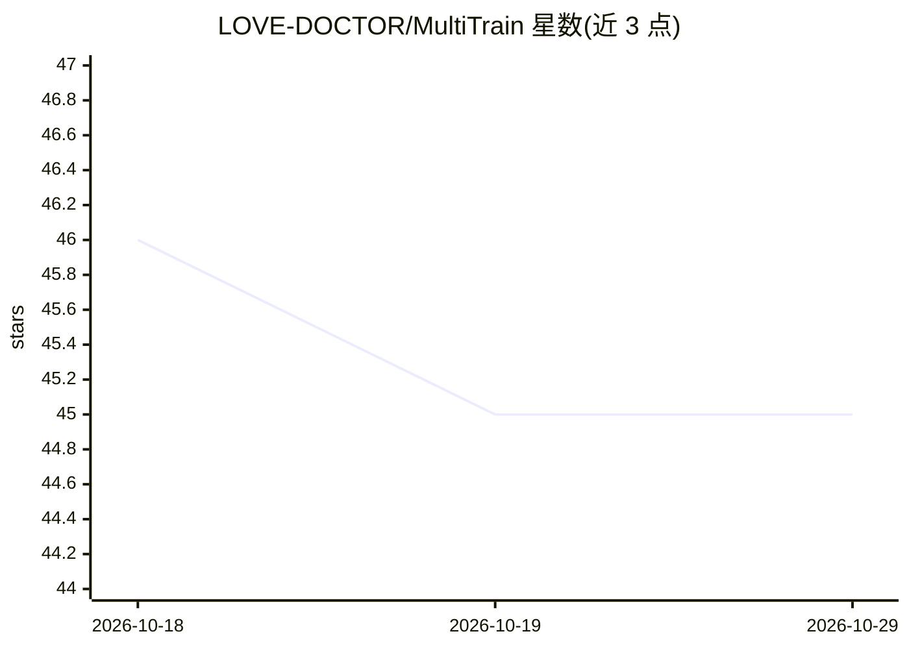

# LOVE-DOCTOR/MultiTrain

⭐ 45 · Python · MIT · 推送 2026-08-14 · [GitHub](https://github.com/LOVE-DOCTOR/MultiTrain) · 个人维护

**Python 库：一次代码批量训练多个机器学习模型并对比指标**

MultiTrain 是面向机器学习从业者的 Python 模块，提供 MultiClassifier 与 MultiRegressor 两个类，将 scikit-learn、XGBoost、CatBoost、LightGBM 等分类/回归估计器集中在一套 fit 接口下并行训练，返回各模型评估指标（accuracy、f1、roc auc、MSE 等）的 pandas 表格。附带数据划分（自动/手动编码、缺失值填充）、PCA 与多种 scaler、return_best_model 按单一指标取最优模型、model_params 自定义参数及引入外部估计器等机制；训练警告与失败按模型分列，单个模型失败不影响其他结果。支持 Python 3.8–3.13，pip 安装，macOS 需先装 libomp。

## 筛选速览

| 维度 | 判定 | 备注 |
|---|---|---|
| AI 角色 | `ai-ecosystem` | LLM/agent 周边工具 |
| 许可风险 | `permissive` | MIT |
| 部署形态 | `library` | 以包/库形式分发 |
| 模型依赖 | — | README 未给出锁定关系 |
| 硬件要求 | — | 无带数字的原话,不猜 |
| 安装摩擦 | `low` | 无编译、无系统依赖或容器化 |
| 成熟度 | — | 结构信号不足 |

## 能力要点

- MultiClassifier/MultiRegressor 批量训练多模型并输出指标对比表
- split 接口集成自动/手动编码与缺失值填充（ffill/bfill/interpolate）
- return_best_model 按单一指标返回最优模型，model_params 与外部估计器可复用配置
- model_workers 多进程并行、warnings_/failures_ 分离记录各模型状态

## 适用场景

- 拿到新数据集后快速筛选表现较好的分类或回归模型
- 在 notebook 中批量对比多个估计器的多项指标
- 并行训练多模型并直接取最优模型用于后续调参与部署

## 场景标签

 · 领域:机器学习工具库

## 证据(README 行号)

> L32: MultiTrain is a python module for machine learning, built with the aim of assisting you to find the machine learnin
> L70: The MultiClassifier is a combination of many classifier estimators, each of which is fitted on the training data an

## 星数曲线

2026-10-18 46 → 2026-10-29 45（-1）

---
*卡片 v1 · prompt 1.4 · 生成 2026-10-25 · 置信度 high · 依据 README sha `9227e779165f` · [字段定义](../../DATASET.md)*
