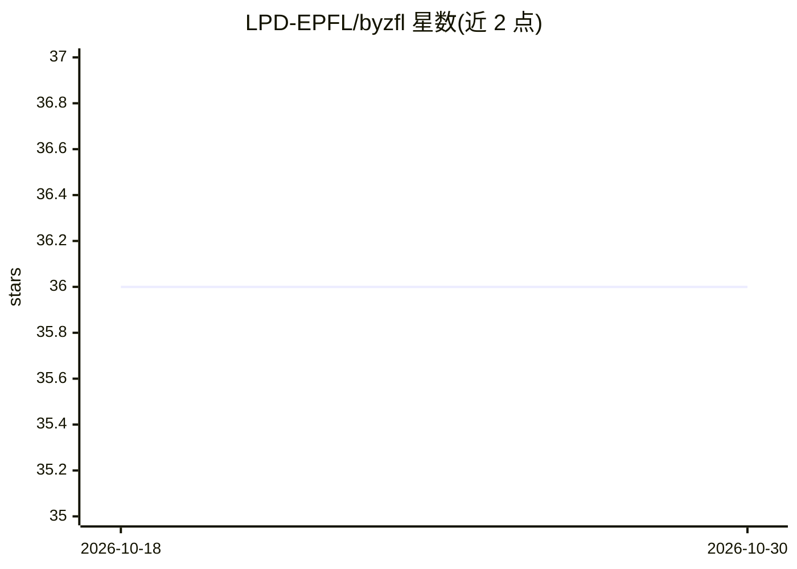

# LPD-EPFL/byzfl

⭐ 36 · Python · MIT · 推送 2026-10-02 · [GitHub](https://github.com/LPD-EPFL/byzfl) · [官网](https://byzfl.epfl.ch/) · 组织维护

**健壮联邦学习 Python 库：抗拜占庭聚合与攻击仿真**

由 EPFL DCL 与 INRIA Rennes WIDE 开发的 Python 库，面向联邦学习稳健性研究：提供抗拜占庭参与者的聚合器与前聚合器、多种拜占庭攻击仿真、端到端联邦学习模拟环境（诚实/拜占庭客户端与中央服务器），以及对抗条件下的自动化基准评测框架。兼容 PyTorch 张量与 NumPy 数组。通过 pip 安装，附 BibTeX 引用，MIT 许可。

## 筛选速览

| 维度 | 判定 | 备注 |
|---|---|---|
| AI 角色 | `ai-native` | 本体是模型或模型工具 |
| 许可风险 | `permissive` | MIT |
| 部署形态 | `library` | 以包/库形式分发 |
| 模型依赖 | — | README 未给出锁定关系 |
| 硬件要求 | — | 无带数字的原话,不猜 |
| 安装摩擦 | `low` | 无编译、无系统依赖或容器化 |
| 成熟度 | — | 结构信号不足 |

## 能力要点

- 抗拜占庭聚合器与前聚合器（如 TrMean）
- 多种拜占庭攻击仿真（如 SignFlipping）
- 客户端-服务器端到端联邦学习模拟环境
- 对抗条件下的自动化基准评测框架

## 适用场景

- 测试联邦学习算法在拜占庭攻击下的稳健性
- 仿真含恶意客户端的分布式训练场景
- 对比不同鲁棒聚合策略的表现

## 场景标签

`模型评测` · 领域:评测与运维

## 证据(README 行号)

> L7: ByzFL is a **Python library for robust Federated Learning**. It is fully compatible with both PyTorch tensors and Nu
> L15: 3. **Federated Learning Framework/Simulation**:
> L96: If you use **ByzFL** in your research, please cite:

## 星数曲线

2026-10-18 36 → 2026-10-30 36（+0）

---
*卡片 v1 · prompt 1.4 · 生成 2026-10-25 · 置信度 high · 依据 README sha `7cb522ce8797` · [字段定义](../../DATASET.md)*
