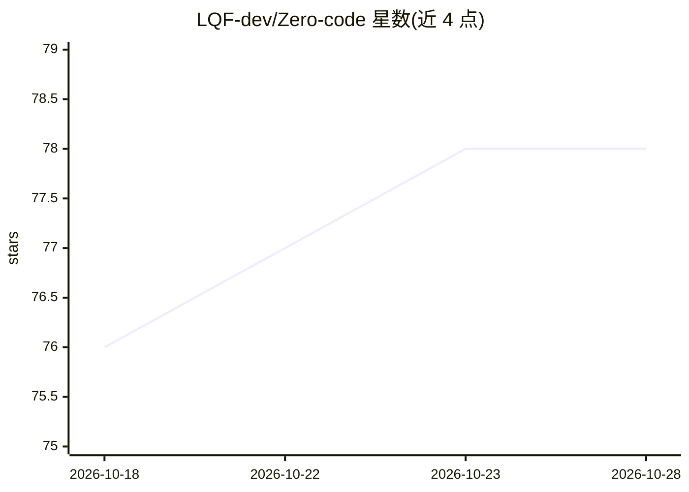

# LQF-dev/Zero-code

⭐ 79 · Java · MIT · 推送 2026-05-09 · [GitHub](https://github.com/LQF-dev/Zero-code) · 个人维护 · 中文 README

**面向用户的 AI 代码生成平台：生成、修改、预览到本地部署**

基于 Spring Boot、LangChain4j 与 LangGraph4j 构建的 AI 代码生成平台，支持 HTML、多文件与 Vue 工程三类代码生成。提供双引擎架构（工具调用模式与工作流编排模式）、带 DAG 依赖的结构化 TODO 任务计划、三层上下文压缩（工具结果微压缩 / 自动摘要 / 手动压缩）、SSE 过程可视化、预览页选元素定点修改与生成后本地一键部署；记忆采用 Redis 短期记忆 + MySQL 长期事件日志，支持从事件日志回放重建。模型通过 OpenAI 兼容接口配置，默认适配 DeepSeek。运行需 JDK 21+、Node.js 18+、MySQL 8+、Redis 6+。

## 筛选速览

| 维度 | 判定 | 备注 |
|---|---|---|
| AI 角色 | `ai-native` | 本体是模型或模型工具 |
| 许可风险 | `permissive` | MIT |
| 部署形态 | `library` | 以包/库形式分发 |
| 模型依赖 | locked-api |  |
| 硬件要求 | — | 无带数字的原话,不猜 |
| 安装摩擦 | `medium` | 含编译或系统依赖之一 |
| 成熟度 | — | 结构信号不足 |

## 能力要点

- 双引擎：LangChain4j 工具调用与 LangGraph4j 工作流编排可切换
- 三层上下文压缩（微压缩 / LLM 自动摘要 / 手动压缩）降低长对话 token 压力
- updatePlan 维护带 DAG 依赖的任务计划并持久化到 Redis
- SSE 实时推送思考、工具调用、计划更新与最终回复，事件落库可回放

## 适用场景

- 对话式生成网页或 Vue 工程代码并本地预览
- 在预览页点选元素做定点修改
- 长会话 Agent 开发中控制上下文膨胀
- 生成后一键构建部署到本地静态地址

## 场景标签

`代码生成` `编码 Agent` · 领域:编码与开发

## 证据(README 行号)

> L5: **一个支持任务计划、上下文压缩与可视化生成过程的 AI 代码生成平台**
> L24: Zero Code Studio 是一个以工程化为目标的 AI 代码生成平台。
> L39: - **生成-修改-部署闭环**：支持 `HTML / 多文件 / Vue 工程`三种代码类型生成，可视化选中元素定点修改，生成后自动构建并部署到本地可访问地址。

## 星数曲线

2026-10-18 76 → 2026-10-28 78（+2）

---
*卡片 v1 · prompt 1.4 · 生成 2026-10-24 · 置信度 mid · 依据 README sha `54b4aa787268` · [字段定义](../../DATASET.md)*
