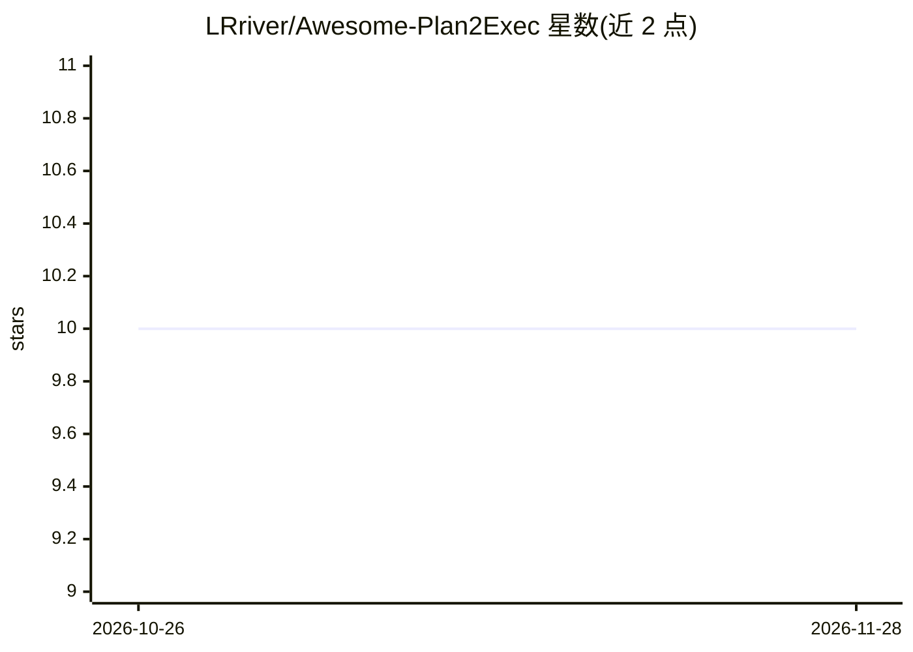

# LRriver/Awesome-Plan2Exec

⭐ 10 · Python · Apache-2.0 · 推送 2026-07-08 · [GitHub](https://github.com/LRriver/Awesome-Plan2Exec) · 个人维护 · 中文 README

**面向规划 Agent 训练的两阶段偏好数据构建流水线**

该项目通过两个递进阶段构建训练数据：第一阶段从 163,180 条对话数据中自动挖掘"任务场景→工具集"映射，采用 LLM 语义标注、Embedding+UMAP+HDBSCAN 聚类与场景生成，产出 4,701 个场景；第二阶段基于上游输出运行四阶段流水线（问题生成→正负样本采样→规则预打分+选择性 LLM Judge→偏好对构建），生成 8 种难度类型的问题与多类受控负样本，输出用于 SFT/DPO/RL 预热、奖励校准与离线评测的偏好数据，配置支持分阶段模型档位与断点续跑。

## 筛选速览

| 维度 | 判定 | 备注 |
|---|---|---|
| AI 角色 | `ai-knowledge` | 知识聚合/清单类 |
| 许可风险 | `permissive` | Apache-2.0 |
| 部署形态 | `library` | 以包/库形式分发 |
| 模型依赖 | — | README 未给出锁定关系 |
| 硬件要求 | — | 无带数字的原话,不猜 |
| 安装摩擦 | `low` | 无编译、无系统依赖或容器化 |
| 成熟度 | — | 结构信号不足 |

## 能力要点

- 两阶段数据构建：场景-工具集挖掘 + 偏好数据合成
- 8 种难度类型问题生成（simple/parallel/adversarial/safety 等）与多类受控负样本
- 10 维度 Rubric 评分体系，规则预打分+选择性 LLM Judge 控制成本
- 生产模式固定策略检查点，保证全量数据可复现

## 适用场景

- 为规划 Agent 训练合成 SFT/DPO/RL 预热数据
- 构建工具推荐与多工具编排的场景-工具集数据
- 校准规划任务的奖励模型并做离线评测

## 场景标签

`模型评测` · 领域:评测与运维

## 证据(README 行号)

> L6: The ultimate goal of this project is to **train a Planning Agent** capable of generating structured, reasonable task
> L8: To achieve this, we designed a complete data construction pipeline with two progressive stages:
> L93: Built on top of the upstream scenario-toolset data, this module runs a four-stage pipeline — Question Generation → 

## 星数曲线

2026-10-26 10 → 2026-11-28 10（+0）

---
*卡片 v1 · prompt 1.4 · 生成 2026-11-20 · 置信度 high · 依据 README sha `227204c5c9ce` · [字段定义](../../DATASET.md)*
