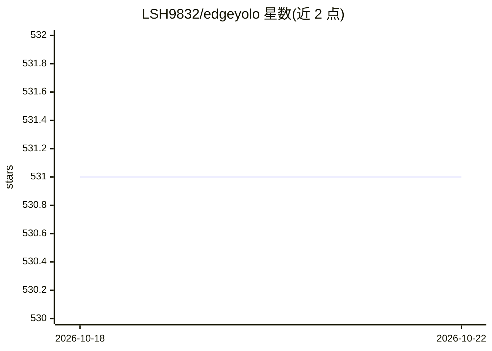

# LSH9832/edgeyolo

⭐ 531 · Python · Apache-2.0 · 推送 2026-04-20 · [GitHub](https://github.com/LSH9832/edgeyolo) · 个人维护 · 中文 README

**面向边缘设备的无锚框实时目标检测器（含训练与多平台部署）**

EdgeYOLO 是一个 anchor-free 单阶段目标检测模型，在 COCO2017 上达到 50.6% AP、在 Jetson AGX Xavier 上 34FPS（TensorRT fp16）。提供从源码安装、训练（支持 COCO/YOLO/VOC/VisDrone/DOTA 五种数据集格式）、评估、ONNX 与 TensorRT（fp16/int8 校准量化）导出的完整流程，并附 C++ 推理示例；可通过 docker 镜像一键导出 RKNN、MNN、昇腾 om、Jetson 等平台的部署模型。注意：TensorRT 8.4+ 半精度转换可能掉精度，需用 7.X 或 8.2.X；DOTA 数据集仅支持单 GPU 训练。

## 筛选速览

| 维度 | 判定 | 备注 |
|---|---|---|
| AI 角色 | `ai-native` | 本体是模型或模型工具 |
| 许可风险 | `permissive` | Apache-2.0 |
| 部署形态 | `self-host` | docker 或自建部署 |
| 模型依赖 | — | README 未给出锁定关系 |
| 硬件要求 | — | 无带数字的原话,不猜 |
| 安装摩擦 | `low` | 无编译、无系统依赖或容器化 |
| 成熟度 | — | 结构信号不足 |

## 能力要点

- 提供 Tiny/S/M/L 多档预训练模型（COCO2017 与 VisDrone2019）
- 支持导出 ONNX、TensorRT fp16/int8（含校准）及 RKNN/MNN/昇腾/Jetson 部署模型
- 训练支持 COCO/YOLO/VOC/VisDrone/DOTA 五种数据集格式
- 提供 Python 与 C++ 两套推理代码及 docker 导出镜像

## 适用场景

- 在 Jetson、RK3588 等边缘设备上做实时目标检测
- 用自己的数据集训练并导出多平台部署模型
- 无人机航拍（VisDrone）场景的目标检测

## 场景标签

`目标检测` · 领域:感知与多模态

## 证据(README 行号)

> L10: - EdgeYOLO 在嵌入式设备 Nvidia Jetson AGX Xavier 上达到了34FPS，在COCO2017数据集上有**50.6**% AP的准确度，在VisDrone2019-DET数据集上有**25.9**%
> L119: ```shell

## 星数曲线



2026-10-18 531 → 2026-10-22 531（+0）


---
*卡片 v1 · prompt 1.4 · 生成 2026-10-21 · 置信度 high · 依据 README sha `6df918e0b308` · [字段定义](../../DATASET.md)*
