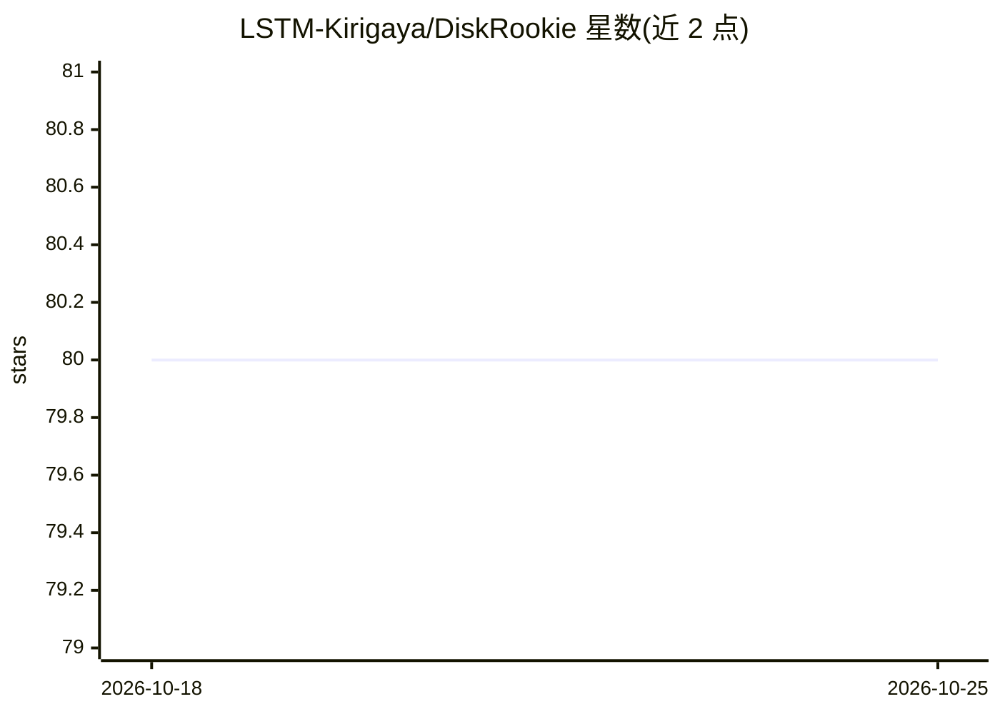

# LSTM-Kirigaya/DiskRookie

⭐ 80 · TypeScript · NOASSERTION · 推送 2026-04-12 · [GitHub](https://github.com/LSTM-Kirigaya/DiskRookie) · 个人维护 · 中文 README

**面向小白的 AI 磁盘清理助手：扫描分析并建议删除或迁移**

基于 Rust 核心与 Tauri 构建的桌面磁盘清理工具：先以 Rust 扫描磁盘占用（README 标称最高 1 秒扫描 5000 个文件），再由 AI 系统分析文件用途，给出删除或迁移建议，所有建议需用户确认。迁移目标支持 Google Drive、OneDrive、阿里云盘、百度网盘及 WebDAV NAS。兼容本地 Ollama 与夸克/Dropbox 等云存储列为开发计划中尚未实现的功能。安装需自行克隆源码并用 Rust 1.86+ 与 Node.js 20+ 构建调试，或通过 npx tauri build 构建 Windows 发布版。

## 筛选速览

| 维度 | 判定 | 备注 |
|---|---|---|
| AI 角色 | `ai-enhanced` | 去掉 AI 部分产品仍成立 |
| 许可风险 | `none` | NOASSERTION |
| 部署形态 | `library` | 以包/库形式分发 |
| 模型依赖 | — | README 未给出锁定关系 |
| 硬件要求 | — | 无带数字的原话,不猜 |
| 安装摩擦 | `low` | 无编译、无系统依赖或容器化 |
| 成熟度 | — | 结构信号不足 |

## 能力要点

- Rust 核心磁盘扫描，低内存占用，支持百万级文件
- AI 分析文件用途并给出删除/迁移建议，需用户确认
- 一键迁移文件到 Google Drive、OneDrive、阿里云盘、百度网盘或 WebDAV NAS

## 适用场景

- 不熟悉电脑的用户清理磁盘空间
- 把大文件一键迁移到云盘或 NAS 释放本地空间
- 查看磁盘占用情况并获得清理建议

## 场景标签

 · 领域:系统工具/桌面应用

## 证据(README 行号)

> L10:  让小白用户也能像电脑糕手一样清理磁盘。
> L33: - 🤖 **AI 智能分析**：扫描完成后由 AI 系统自动分析文件用途，智能决定哪些需要删除、哪些需要迁移，所有建议需用户确认确保安全。

## 星数曲线

2026-10-18 80 → 2026-10-25 80（+0）

---
*卡片 v1 · prompt 1.4 · 生成 2026-10-24 · 置信度 mid · 依据 README sha `b34799568f51` · [字段定义](../../DATASET.md)*
