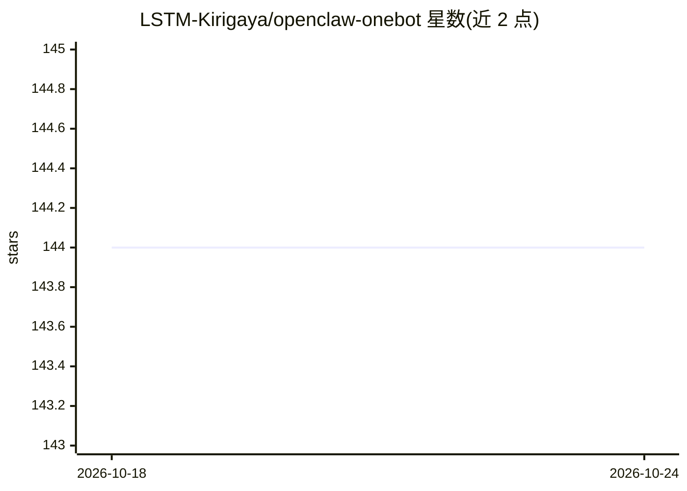

# LSTM-Kirigaya/openclaw-onebot

⭐ 144 · TypeScript · MIT · 推送 2026-05-07 · [GitHub](https://github.com/LSTM-Kirigaya/openclaw-onebot) · 个人维护 · 中文 README

**OpenClaw 的 OneBot v11 渠道插件，用于 QQ 接入 AI 助手**

面向 OpenClaw agent 框架的 TypeScript 渠道插件：通过 OneBot v11 协议接入 QQ（NapCat、go-cqhttp、Lagrange.Core 等服务端），支持正向/反向 WebSocket 连接、@与关键字触发、私聊自动回复、上下文获取、黑白名单、新成员入群欢迎触发器，以及长消息的三种处理模式（分段流式、Markdown 转图片渲染、合并转发）。安装通过 openclaw plugins install 命令完成，需另行安装 OneBot 服务端。

## 筛选速览

| 维度 | 判定 | 备注 |
|---|---|---|
| AI 角色 | `ai-ecosystem` | LLM/agent 周边工具 |
| 许可风险 | `permissive` | MIT |
| 部署形态 | `None` |  |
| 模型依赖 | — | README 未给出锁定关系 |
| 硬件要求 | — | 无带数字的原话,不猜 |
| 安装摩擦 | `low` | 无编译、无系统依赖或容器化 |
| 成熟度 | — | 结构信号不足 |

## 能力要点

- 支持 OneBot v11 正向/反向 WebSocket（ws/wss）连接
- @触发与关键字触发、上下文自动获取
- 长消息三种模式：流式分段、OG 图片渲染（可自定义 CSS 主题）、合并转发
- 黑白名单、新成员入群欢迎与自定义 shell 触发器

## 适用场景

- 让 OpenClaw 助手接入 QQ 私聊与群聊
- 通过关键字或 @ 让机器人在千人大群中回复
- 入群自动发欢迎图、屏蔽指定群成员

## 场景标签

`聊天机器人` · 领域:对话与助手

## 证据(README 行号)

> L3: OpenClaw 的 **OneBot v11 协议**（QQ/Lagrange.Core、go-cqhttp 等）渠道插件。
> L25: - ✅ 私聊：所有消息 AI 都会回复

## 星数曲线

2026-10-18 144 → 2026-10-24 144（+0）

---
*卡片 v1 · prompt 1.4 · 生成 2026-10-22 · 置信度 high · 依据 README sha `dc190b4a2240` · [字段定义](../../DATASET.md)*
