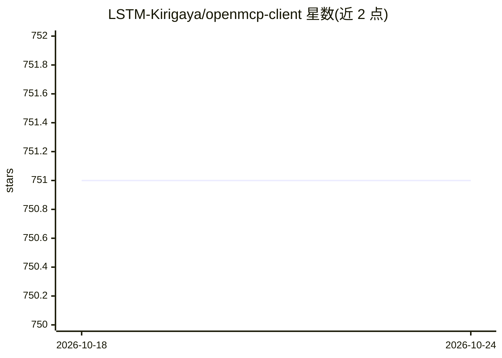

# LSTM-Kirigaya/openmcp-client

⭐ 751 · TypeScript · Apache-2.0 · 推送 2026-06-04 · [GitHub](https://github.com/LSTM-Kirigaya/openmcp-client) · [官网](https://kirigaya.cn/openmcp) · 个人维护 · 中文 README

**VSCode/Trae/Cursor 的 MCP 开发调试一体化插件**

面向 MCP server 开发者的编辑器插件，含 openmcpent 调试器（Inspector 集成、MCP 客户端功能、工具/prompts/resources 测试、交互式测试模块）与 openmcp-sdk（npm 安装，用少量代码将测试过的 MCP 部署为 agent 应用）。支持 DeepSeek、OpenAI、Qwen、Gemini、Ollama 等多种大模型接入，提供项目级管理面板与 CLI 命令行工具。采用分层模块化设计，支持多 MCP server 同时调试。

## 筛选速览

| 维度 | 判定 | 备注 |
|---|---|---|
| AI 角色 | `ai-ecosystem` | LLM/agent 周边工具 |
| 许可风险 | `permissive` | Apache-2.0 |
| 部署形态 | `library` | 以包/库形式分发 |
| 模型依赖 | local-ok | 支持本地模型 |
| 硬件要求 | — | 无带数字的原话,不猜 |
| 安装摩擦 | `low` | 无编译、无系统依赖或容器化 |
| 成熟度 | — | 结构信号不足 |

## 能力要点

- openmcpent 集成 Inspector 与 MCP 客户端基础功能，开发测试一体
- 测试通过的 MCP 工具可放入交互式测试模块与大模型交互
- openmcp-sdk 通过 npm 安装，少量代码将 MCP 部署为 agent 应用
- 支持 DeepSeek/OpenAI/Qwen/Gemini/Ollama 等多种大模型

## 适用场景

- 在编辑器内调试和测试 MCP server 的工具、prompts 与资源
- 测试完成后将 MCP server 快速部署为 agent 应用
- 用 CLI 一条命令搭建并运行 OpenMCP 开发环境

## 场景标签

 · 领域:开发者工具/MCP

## 证据(README 行号)

> L13: An all-in-one vscode/trae/cursor plugin for MCP server debugging.
> L20: Integrated Inspector + MCP client basic functions, combining development and testing into one.
> L34: once everything is tested and verified in `openmcpent`, you can deploy your mcp as an agent app with `openmcp-sdk` 

## 星数曲线

2026-10-18 751 → 2026-10-24 751（+0）

---
*卡片 v1 · prompt 1.4 · 生成 2026-10-21 · 置信度 high · 依据 README sha `eda281013aaf` · [字段定义](../../DATASET.md)*
