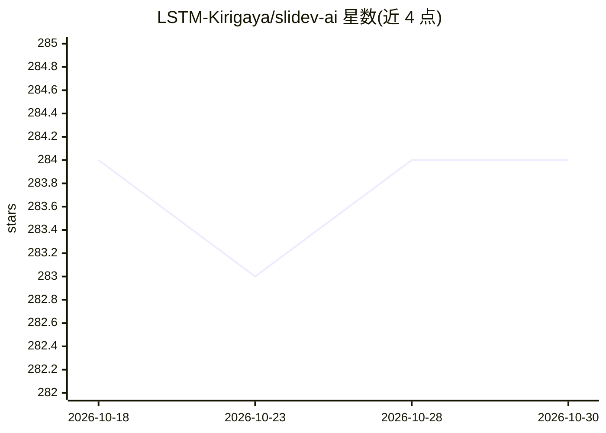

# LSTM-Kirigaya/slidev-ai

⭐ 284 · Vue · MIT · 推送 2026-01-13 · [GitHub](https://github.com/LSTM-Kirigaya/slidev-ai) · 组织维护 · 中文 README

**用 LLM 把高密度文本生成 Slidev 在线演示文稿的 Web 应用**

面向工程师与学术用户的 Web 应用：读取结构化的高密度文本材料，借助 LLM 生成基于 Slidev 的在线演示文稿（PPT+讲稿），适合团队汇报、内部技术分享等文本转幻灯片场景；明确不适用于需要深度理解与重构内容的场景（如论文解读、年报）。技术栈为 NestJS 后端（SQLite、Puppeteer）+ Vite/Vue 前端，通过环境变量配置 OpenAI 兼容 API，提供 Docker 双容器部署。它是 OpenMCP 生态的下游实现，曾获 ModelScope MCP&Agent 竞赛最佳应用奖。

## 筛选速览

| 维度 | 判定 | 备注 |
|---|---|---|
| AI 角色 | `ai-native` | 本体是模型或模型工具 |
| 许可风险 | `permissive` | MIT |
| 部署形态 | `self-host` | docker 或自建部署 |
| 模型依赖 | — | README 未给出锁定关系 |
| 硬件要求 | — | 无带数字的原话,不猜 |
| 安装摩擦 | `low` | 无编译、无系统依赖或容器化 |
| 成熟度 | — | 结构信号不足 |

## 能力要点

- LLM 生成基于 Slidev 的演示文稿与讲稿
- NestJS + SQLite + Puppeteer 后端，Vite+Vue 前端
- docker-compose 双容器部署，数据卷持久化
- OpenMCP agent 开发的参考实现与模板

## 适用场景

- 把结构化的汇报文本快速转成在线幻灯片
- 团队例会、内部技术分享的 PPT 生成
- 作为 OpenMCP 框架构建领域 agent 的参考实现

## 场景标签

`代码生成` · 领域:编码与开发

## 证据(README 行号)

> L11: Slidev-AI is a web app that leverages LLM (Large Language Model) technology to make creating Slidev-based online pr
> L25: Slidev AI is designed for scenarios where you have a high-density text material that you want to present in PPT for

## 星数曲线

2026-10-18 284 → 2026-10-30 284（+0）

---
*卡片 v1 · prompt 1.4 · 生成 2026-10-22 · 置信度 high · 依据 README sha `d4bee5a4c517` · [字段定义](../../DATASET.md)*
