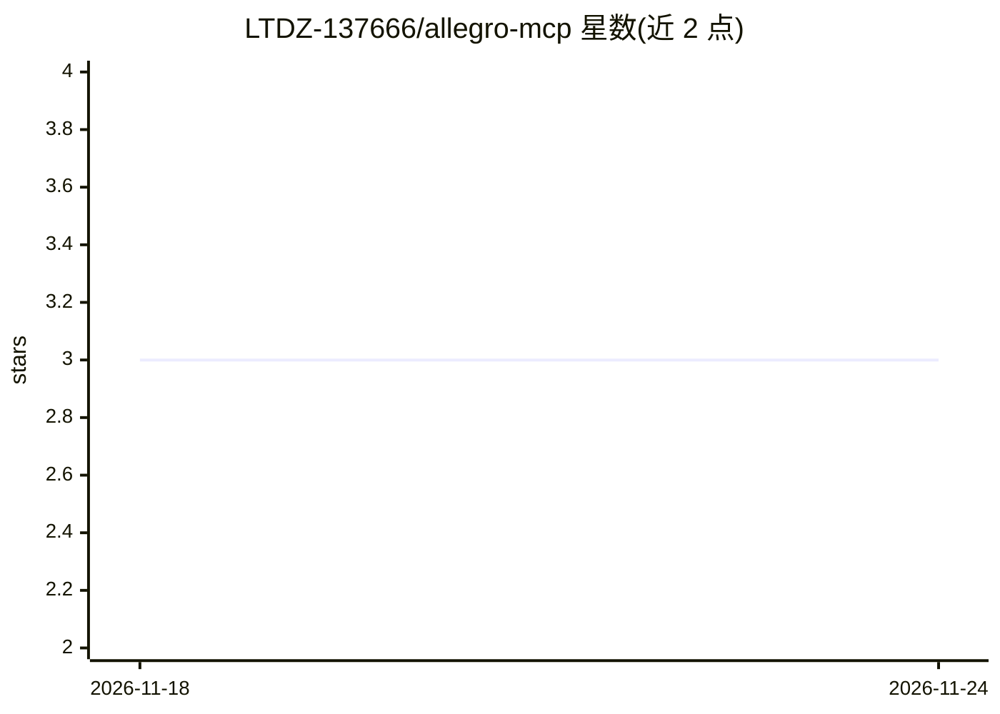

# LTDZ-137666/allegro-mcp

⭐ 3 · Python · NOASSERTION · 推送 2026-11-06 · [GitHub](https://github.com/LTDZ-137666/allegro-mcp) · 个人维护 · 中文 README

**让 AI agent 通过 MCP 读取并操作 Cadence Allegro PCB 编辑器**

面向 Cadence Allegro PCB Editor 的 MCP 桥接工具：Allegro 为闭源商业 EDA，唯一入口是 GUI 进程内的 SKILL 解释器。项目注入一个 C++ 插件 DLL（经 axlDllCall 加载），在 127.0.0.1:57123 启动 TCP 监听，由 Python FastMCP 服务器包装为 25 个 MCP 工具，供 MCP 客户端读取设计信息、管理选择/图层并执行 SKILL。需 Windows 10/11、Python 3.10+ 与 Visual Studio 32 位工具链编译；绑定仅限本机，可配置危险函数确认清单。

## 筛选速览

| 维度 | 判定 | 备注 |
|---|---|---|
| AI 角色 | `ai-ecosystem` | LLM/agent 周边工具 |
| 许可风险 | `none` | NOASSERTION |
| 部署形态 | `None` |  |
| 模型依赖 | — | README 未给出锁定关系 |
| 硬件要求 | — | 无带数字的原话,不猜 |
| 安装摩擦 | `medium` | 含编译或系统依赖之一 |
| 成熟度 | — | 结构信号不足 |

## 能力要点

- 提供 25 个 MCP 工具，覆盖设计读取、图层、选择、测量与 SKILL 执行
- C++ DLL + SKILL 定时器桥接，避免阻塞 Allegro GUI 线程
- 仅绑定 127.0.0.1，并提供可配置的变更类函数确认清单
- 在 Cadence Allegro 25.1 真实设计上做过验证

## 适用场景

- 让 Claude Code、Cursor 等 MCP 客户端查询当前打开的 PCB 设计
- 用自然语言驱动元件选择、图层切换与距离测量
- 在 scratch 板上先验证 agent 操作再应用到正式设计

## 场景标签

 · 领域:EDA/硬件设计自动化

## 证据(README 行号)

> L5: **An MCP bridge that lets AI agents drive Cadence Allegro PCB Editor directly.**
> L7: Cadence Allegro is closed-source commercial EDA with no public API: every operation must go through the SKILL interp

## 星数曲线

2026-11-18 3 → 2026-11-24 3（+0）

---
*卡片 v1 · prompt 1.4 · 生成 2026-11-22 · 置信度 high · 依据 README sha `e22acfb1a30e` · [字段定义](../../DATASET.md)*
