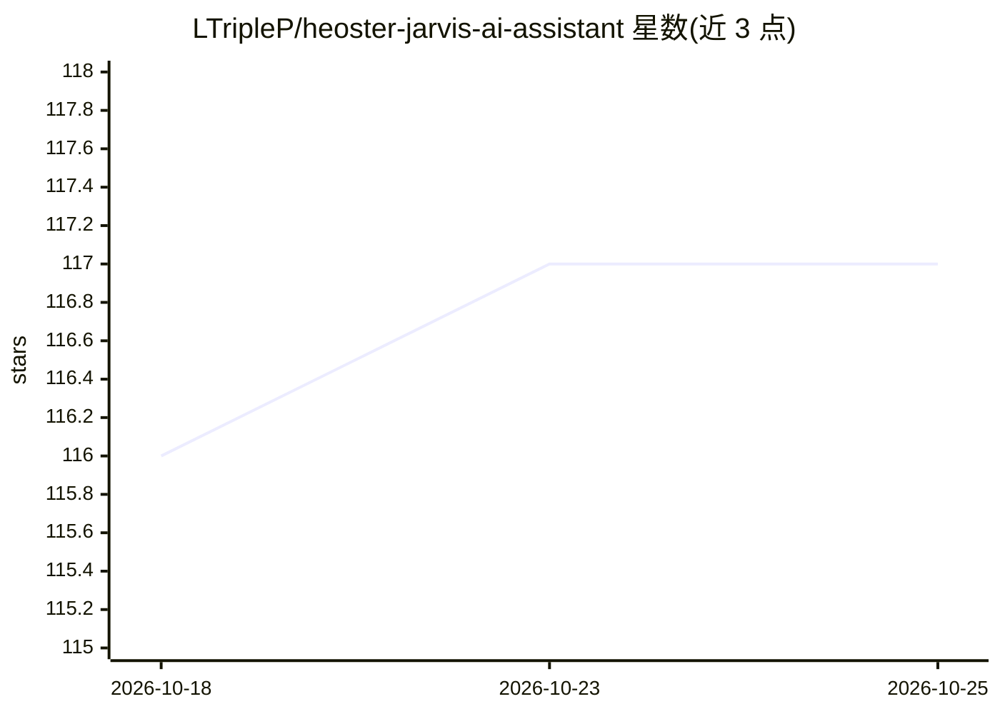

# LTripleP/heoster-jarvis-ai-assistant

⭐ 117 · HTML · 推送 2026-10-25 · [GitHub](https://github.com/LTripleP/heoster-jarvis-ai-assistant) · 组织维护

**个人 AI 助手应用：多模型编排、记忆层与实时数据流**

Codeex AI 开发的个人 AI 助手 HarmoniCus，面向终端用户的多轮对话场景：通过 LangChain 编排多个模型（GPT 类、LLaMA 变体及图像/文本/音频模型）按任务选择并串联；包含短期/长期记忆层（FAISS+Redis 向量存储）、实时网络数据流、多语言对话界面。技术栈为 Python/PyTorch/FastAPI/React。启动器自带虚拟环境与依赖解析，无需手动 pip/npm 安装；需 8GB 内存（完整记忆栈 16GB+）与 OpenAI API key 或兼容本地端点。README 大量使用营销化措辞，可验证的机制细节有限。

## 筛选速览

| 维度 | 判定 | 备注 |
|---|---|---|
| AI 角色 | `ai-native` | 本体是模型或模型工具 |
| 许可风险 | `none` | — |
| 部署形态 | `library` | 以包/库形式分发 |
| 模型依赖 | — | README 未给出锁定关系 |
| 硬件要求 | — | 无带数字的原话,不猜 |
| 安装摩擦 | `low` | 无编译、无系统依赖或容器化 |
| 成熟度 | — | 结构信号不足 |

## 能力要点

- LangChain 编排多模型按任务选择并串联
- Temporal Echo Memory：短期/长期记忆层（FAISS+Redis）
- 实时网络数据流接入 API/新闻/公开数据集
- 启动器自动下载模型权重（轻量 EchoCore 约 2GB）并启动 Web 界面

## 适用场景

- 作为日常个人助手进行多轮连续对话
- 让我在写作和研究时获得带上下文记忆的辅助
- 接入实时数据流获取动态信息

## 场景标签

`AI 助手` · 领域:对话与助手

## 证据(README 行号)

> L7: Heoster's original vision of a personal AI assistant hinted at a future where intelligence is not merely reactive bu
> L31: ### 🧩 **LangChain Orchestrator Pro**

## 星数曲线

2026-10-18 116 → 2026-10-25 117（+1）

---
*卡片 v1 · prompt 1.4 · 生成 2026-10-23 · 置信度 low · 依据 README sha `c29b0ece271f` · [字段定义](../../DATASET.md)*
