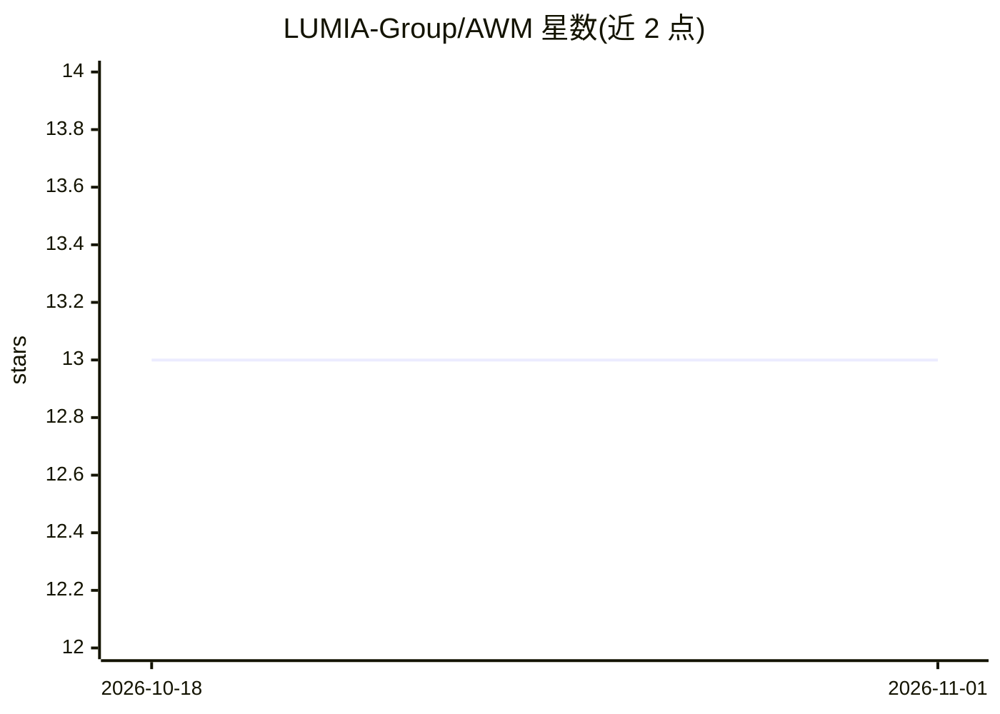

# LUMIA-Group/AWM

⭐ 13 · Python · 推送 2026-02-20 · [GitHub](https://github.com/LUMIA-Group/AWM) · [官网](http://arxiv.org/abs/2510.06738) · 组织维护

**判定 LLM 是否派生自某基座模型的权重指纹方法**

ICLR 2026 论文的官方实现：通过基于线性分配问题（LAP）的维度对齐与无偏 CKA 比较注意力权重，输出相似度得分，用于判定一个开源 LLM 是否派生自另一基座模型。训练无关，单对模型在一张 RTX3090 上约 30 秒，对 SFT/CPT/RL/多模态微调/剪枝/MoE upcycling 及权重变换均报告了鲁棒性结果。以 Python 源码仓库提供，通过 git clone 与 pip 安装依赖运行，支持 CPU/CUDA 设备，附批量下载脚本与预定义实验套件。

## 筛选速览

| 维度 | 判定 | 备注 |
|---|---|---|
| AI 角色 | `ai-ecosystem` | LLM/agent 周边工具 |
| 许可风险 | `none` | — |
| 部署形态 | `library` | 以包/库形式分发 |
| 模型依赖 | — | README 未给出锁定关系 |
| 硬件要求 | — | 无带数字的原话,不猜 |
| 安装摩擦 | `medium` | 含编译或系统依赖之一 |
| 成熟度 | — | 结构信号不足 |

## 能力要点

- LAP 对齐 + 无偏 CKA 的训练无关指纹判定
- 单对模型约 30s/pair（RTX3090），无需训练
- 对 SFT/CPT/RL/剪枝/MoE upcycling 等后训练变体报告鲁棒性
- 提供预定义实验套件与批量模型下载脚本

## 适用场景

- 核验开源模型是否派生自某基座模型
- 模型谱系审计与合规溯源研究
- 复现论文中的 SFT/CPT/剪枝等实验套件

## 场景标签

`模型评测` · 领域:评测与运维

## 证据(README 行号)

> L21: `AWM` is a fingerprinting method to determine whether one large language model (LLM) is derived from another base m
> L33: |**Goal**|Independency test of open-source LLMs based on their weights|

## 星数曲线

2026-10-18 13 → 2026-11-01 13（+0）

---
*卡片 v1 · prompt 1.4 · 生成 2026-10-31 · 置信度 high · 依据 README sha `b1b40e732208` · [字段定义](../../DATASET.md)*
