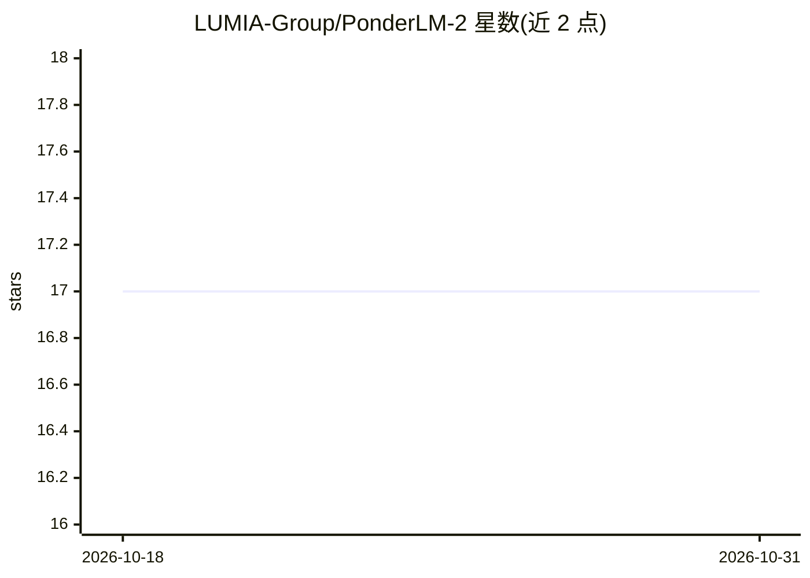

# LUMIA-Group/PonderLM-2

⭐ 17 · Python · Apache-2.0 · 推送 2026-05-06 · [GitHub](https://github.com/LUMIA-Group/PonderLM-2) · [官网](https://www.arxiv.org/abs/2509.23184) · 组织维护

**ICML 2026 论文官方实现：连续空间潜思考预训练 LLM**

LLaMA-Factory 的精简分支，实现 PonderLM-2 预训练方法：模型在预测每个下一 token 前先生成若干连续空间的潜思考向量（末层隐藏态）并回送自身，通过 --patch_method 一个标志即可在 PonderLM-2、PonderLM、Loop、Pause Token、vanilla 五种方法间切换，覆盖 Llama 与 GPT-NeoX。提供逐脚本复现论文 Table 3 实验、410m 低算力对照实验、quickstart，并在 Hugging Face Hub 发布 Pythia-1.4b 与 410m checkpoint。测试环境为 PyTorch 2.4 + CUDA 12.1，8×A100/8×H100/8×RTX4090。

## 筛选速览

| 维度 | 判定 | 备注 |
|---|---|---|
| AI 角色 | `ai-native` | 本体是模型或模型工具 |
| 许可风险 | `permissive` | Apache-2.0 |
| 部署形态 | `None` |  |
| 模型依赖 | — | README 未给出锁定关系 |
| 硬件要求 | — | 无带数字的原话,不猜 |
| 安装摩擦 | `medium` | 含编译或系统依赖之一 |
| 成熟度 | — | 结构信号不足 |

## 能力要点

- --patch_method 一标志切换 5 种方法（PonderLM-2/PonderLM/Loop/Pause/vanilla）
- 潜思考向量经 Jacobi 并行迭代求解（--num_jacobi_iterations）
- HF Hub 发布 Pythia-1.4b 与 410m checkpoint，GPT-NeoX 版 from_pretrained 直接加载
- 提供 quickstart、410m 低算力对照与 Table 3 复现脚本

## 适用场景

- 复现或验证潜思考预训练方法的论文实验
- 对比不同 test-time/预训练思考方法在相同数据与预算下的表现
- 在算力不足时用 410m smallpile 实验做方法验证
- 基于发布 checkpoint 做推理与下游评测

## 场景标签

`模型训练` · 领域:训练与推理

## 证据(README 行号)

> L10: > **TL;DR.** Chain-of-Thought scales test-time compute by generating extra
> L28: A slim fork of LLaMA-Factory
> L34: |`ours`|**PonderLM-2** (this paper)|Zeng et al., ICML 2026|

## 星数曲线

2026-10-18 17 → 2026-10-31 17（+0）

---
*卡片 v1 · prompt 1.4 · 生成 2026-10-30 · 置信度 high · 依据 README sha `387f9472fbc2` · [字段定义](../../DATASET.md)*
