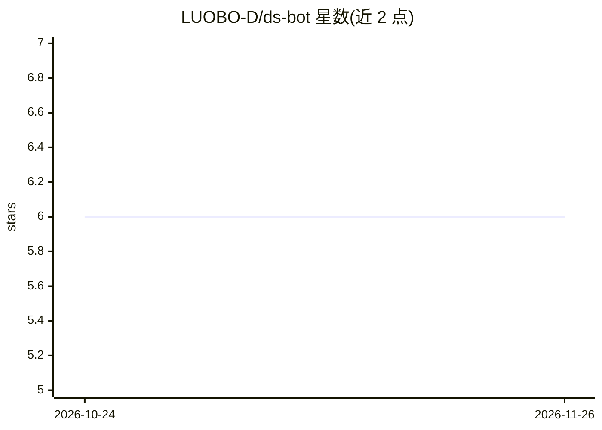

# LUOBO-D/ds-bot

⭐ 6 · Python · MIT · 推送 2026-10-24 · [GitHub](https://github.com/LUOBO-D/ds-bot) · 个人维护 · 中文 README

**给 QQ 个人号接入 AI 人格聊天：角色卡、记忆、情绪、识图语音**

以 Python + FastAPI 为桥接、NapCatQQ 为协议端的 QQ 个人号机器人框架：通过 OpenAI 兼容的 Chat Completions 接口（默认 DeepSeek）生成对话，支持多角色卡热切换、30 条上下文与事实/情节记忆及夜间巩固、三维情绪与日程推进、识图（OCR + 视觉模型）、SenseVoice 本地语音转写、表情包收藏与 QQ 空间互动。面向想在 QQ 上搭建'像人一样聊天'机器人的个人用户。面向 Windows，需专用 QQ 小号，存在风控封号风险。

## 筛选速览

| 维度 | 判定 | 备注 |
|---|---|---|
| AI 角色 | `ai-native` | 本体是模型或模型工具 |
| 许可风险 | `permissive` | MIT |
| 部署形态 | `desktop` | 安装包/桌面程序 |
| 模型依赖 | local-ok | 支持本地模型 |
| 硬件要求 | — | 无带数字的原话,不猜 |
| 安装摩擦 | `low` | 无编译、无系统依赖或容器化 |
| 成熟度 | — | 结构信号不足 |

## 能力要点

- 角色卡多张热切换，记忆/情绪/生活线按角色隔离
- 30 条上下文 + 备忘 + 事实/情节记忆 + 夜间巩固的记忆体系
- 识图（OCR + 视觉模型）与 SenseVoice 本地语音转写
- 任意 OpenAI 兼容服务可换 base_url/model 接入

## 适用场景

- 在 QQ 上搭一个有人设、会记事的 AI 聊天机器人
- 让机器人识图、听语音、按喜好发表情包
- 接入自选的大模型 API 跑私聊人格对话

## 场景标签

`聊天机器人` · 领域:对话与助手

## 证据(README 行号)

> L13: `ds-bot` 是「AI 人格 + QQ」的胶水层：
> L17: - **大脑**：任何 **OpenAI 兼容的 Chat Completions** 服务（默认 DeepSeek），换 base_url / model 即可换成别的
> L20: 它不是客服机器人，是一个「像人一样聊天」的框架：会分条说话、记得你说过的事、有自己的日程和情绪、

## 星数曲线

2026-10-24 6 → 2026-11-26 6（+0）

---
*卡片 v1 · prompt 1.4 · 生成 2026-11-20 · 置信度 mid · 依据 README sha `39ed6883d80d` · [字段定义](../../DATASET.md)*
