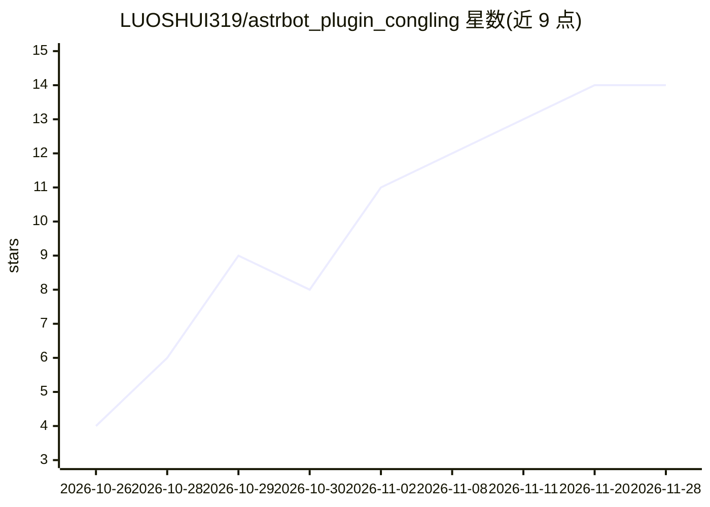

# LUOSHUI319/astrbot_plugin_congling

⭐ 14 · Python · 推送 2026-11-15 · [GitHub](https://github.com/LUOSHUI319/astrbot_plugin_congling) · [官网](https://github.com/LUOSHUI319/astrbot_plugin_congling) · 个人维护 · 中文 README

**AstrBot 插件：让 QQ 陪伴机器人聊得像人、会记会睡会做梦**

运行在 AstrBot 框架上的可插拔增强插件，面向 QQ（OneBot v11）聊天场景。八个模块：拟人化回复（打分决定回不回、分句与发送节奏、输出守卫）、五级衰减的长期记忆（BM25+向量召回、0 级永久档判据、好感度结算、用户画像）、特殊消息解析（合并转发/引用/图片/语音）、四阶段睡眠与 REM 做梦、日记、主动找人、实用查询工具、QQ 空间直连扩展。零强制依赖（标准库 sqlite3），带桌面与手机两套可视化配置面板，共 241 项配置；与 private_companion、livingmemory 等同类插件自动探测让位。

## 筛选速览

| 维度 | 判定 | 备注 |
|---|---|---|
| AI 角色 | `ai-native` | 本体是模型或模型工具 |
| 许可风险 | `none` | — |
| 部署形态 | `None` |  |
| 模型依赖 | — | README 未给出锁定关系 |
| 硬件要求 | — | 无带数字的原话,不猜 |
| 安装摩擦 | `low` | 无编译、无系统依赖或容器化 |
| 成熟度 | — | 结构信号不足 |

## 能力要点

- 分级长期记忆：五级衰减加 0 级永久档，BM25+可选向量 RRF 融合召回
- 长夜如梦：精力、睡眠阶段（90 分钟周期）、只在 REM 做梦、掷骰唤醒
- QQ 扩展直连空间接口：说说、好友动态、点赞评论、换头像，带隐私过滤与配额
- 桌面 + 手机两套可视化面板，15 个分区 241 项配置

## 适用场景

- 给 AstrBot 的 QQ 群聊/私聊机器人加拟人化回复节奏和记忆能力
- 让陪伴型机器人有作息、做梦和日记等拟人行为
- 通过面板集中管理机器人人格、行为与 QQ 空间扩展

## 场景标签

`聊天机器人` `Agent 记忆` · 领域:Agent 开发

## 证据(README 行号)

> L16: > 把「会聊天」这件事做到像人。拟人化表达、分句节奏、会淡忘的分级记忆、特殊消息解析、长夜如梦（会累会睡、有睡眠阶段、会做梦、说了晚安会安静但不睡着）、日记、主动找人、实用查询、QQ 扩展（空间说说带图 / 好友动态 / 评论点赞
> L341: 本插件**不自建对话主循环**，是一层可插拔增强。启动时探测：

## 星数曲线

2026-10-26 4 → 2026-11-28 14（+10）

---
*卡片 v1 · prompt 1.4 · 生成 2026-11-18 · 置信度 high · 依据 README sha `21abab452626` · [字段定义](../../DATASET.md)*
