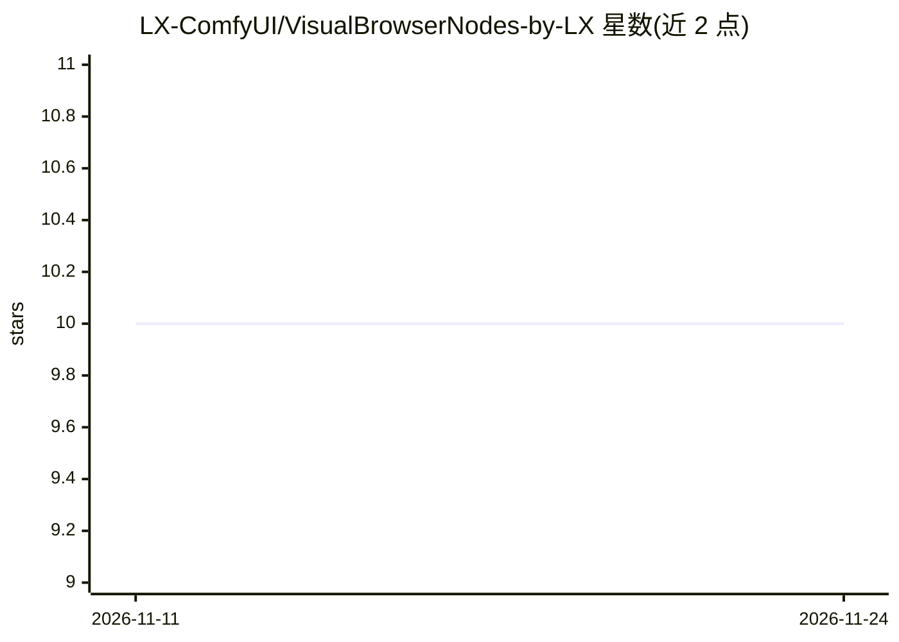

# LX-ComfyUI/VisualBrowserNodes-by-LX

⭐ 10 · JavaScript · 推送 2026-08-16 · [GitHub](https://github.com/LX-ComfyUI/VisualBrowserNodes-by-LX) · 个人维护

**ComfyUI 可视化浏览器节点：网格浏览与加载本地模型和 LoRA**

一套 ComfyUI 自定义节点，提供 3 个加载器（LoRA、Checkpoint、Diffusion Model），将默认下拉列表替换为缩略图网格界面。从 Civitai 拉取预览图、Base Model 与 LoRA 信息、触发词，支持按文件名/文件夹搜索、按 Base Model 过滤、SFW/NSFW 分离视图、个人备注与自定义封面，键盘方向键导航。通过 ComfyUI Manager 或 git clone 手动安装。

## 筛选速览

| 维度 | 判定 | 备注 |
|---|---|---|
| AI 角色 | `ai-ecosystem` | LLM/agent 周边工具 |
| 许可风险 | `none` | — |
| 部署形态 | `None` |  |
| 模型依赖 | — | README 未给出锁定关系 |
| 硬件要求 | — | 无带数字的原话,不猜 |
| 安装摩擦 | `low` | 无编译、无系统依赖或容器化 |
| 成熟度 | — | 结构信号不足 |

## 能力要点

- 3 个可视化加载器节点：LoRA/Checkpoint/Diffusion Model
- Civitai 集成：拉取预览图、Base Model 信息与触发词
- SFW/NSFW 分离视图与逐条图片隐藏/模糊控制
- 键盘方向键或 WASD 网格导航

## 适用场景

- 在 ComfyUI 中以缩略图网格浏览和选择本地模型
- 从 Civitai 直接查看触发词与元数据信息
- 直播或录屏时隐藏 NSFW 内容

## 场景标签

`图像生成` · 领域:内容生成

## 证据(README 行号)

> L24: This suite provides 3 separate nodes:
> L39: * **🌐 Basic Civitai Integration:** Fetch the primary preview image, Base Model & LoRA info, and Trigger Words direc

## 星数曲线

2026-11-11 10 → 2026-11-24 10（+0）

---
*卡片 v1 · prompt 1.4 · 生成 2026-11-20 · 置信度 high · 依据 README sha `edde66e8bc1b` · [字段定义](../../DATASET.md)*
