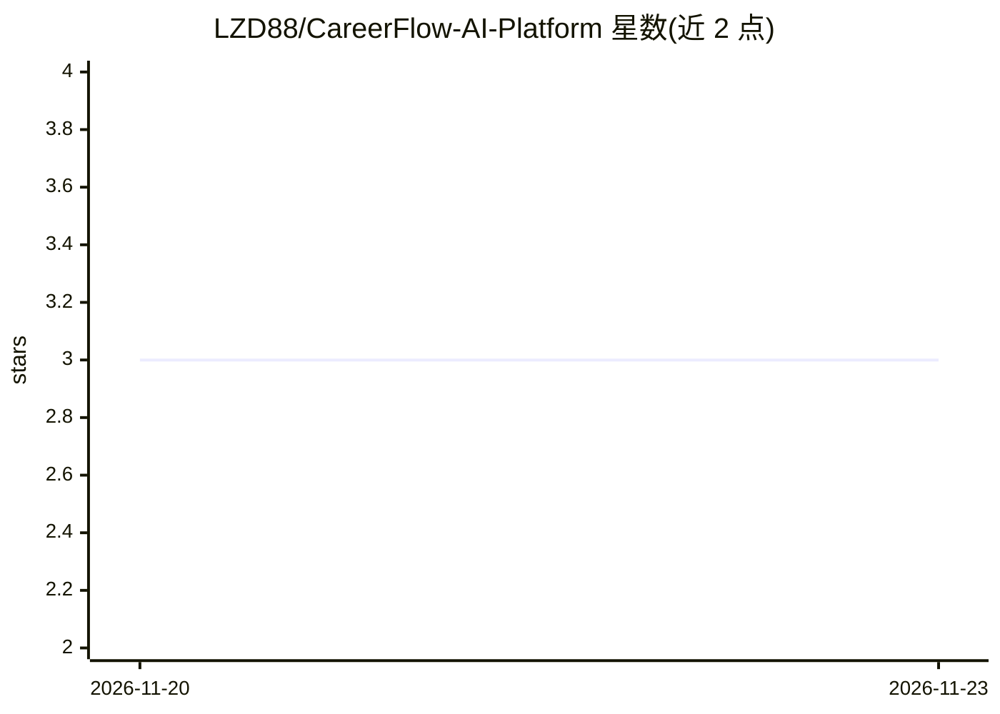

# LZD88/CareerFlow-AI-Platform

⭐ 3 · Java · 推送 2026-11-11 · [GitHub](https://github.com/LZD88/CareerFlow-AI-Platform) · 个人维护 · 中文 README

**面向职业培训机构的报名收款与 AI 面试辅导业务平台**

前后端分离的业务平台：Java 侧负责课程商品、报名订单、支付流水、事务化入班、教学履约、RBAC 权限；Python FastAPI 侧提供知识问答（向量召回、rerank、流式生成）、面试复盘、运营内容生成、SQL 数据分析与日志诊断。跨服务流式问答由 Python 返回 NDJSON、Java 转 SSE 增量输出。覆盖运营、讲师、学员三类角色；README 声明真实支付、语音、RAG 外部服务尚未逐项验收，密码为开发阶段明文存储。

## 筛选速览

| 维度 | 判定 | 备注 |
|---|---|---|
| AI 角色 | `ai-enhanced` | 去掉 AI 部分产品仍成立 |
| 许可风险 | `none` | — |
| 部署形态 | `None` |  |
| 模型依赖 | — | README 未给出锁定关系 |
| 硬件要求 | — | 无带数字的原话,不猜 |
| 安装摩擦 | `medium` | 含编译或系统依赖之一 |
| 成熟度 | `idea` | |

## 能力要点

- 支付回调幂等：SDK 验签后首次成功才累加实收，重复通知不重复入账
- 订单行锁与事务控制的事务化入班，管理端与学员 API 复用同一服务
- Python NDJSON→Java SSE 的跨服务流式问答与会话持久化
- AI 能力覆盖知识问答、面试辅导、运营内容、数据分析、日志诊断六项

## 适用场景

- 培训机构统一管理报名收款、入班与教学交付
- 学员做知识问答与模拟面试复盘
- 运营侧用 AI 生成选题与文案草稿

## 场景标签

`RAG` `数据分析` `AI 写作` · 领域:效率与自动化

## 证据(README 行号)

> L5: 基于 **Spring Boot 3 + MyBatis + Redis/Redisson + FastAPI + React** 的前后端分离项目。Java 负责业务规则、权限与数据一致性，Python 提供模型编排和知识检索能力
> L17: - **学员能力层**：提供报名、入班、问答与模拟面试等后端 API；本仓库提供 React 管理端，未包含独立学员前端。
> L105: ## 5. AI 应用能力

## 星数曲线

2026-11-20 3 → 2026-11-23 3（+0）

---
*卡片 v1 · prompt 1.4 · 生成 2026-11-22 · 置信度 high · 依据 README sha `f6e4b0108a29` · [字段定义](../../DATASET.md)*
