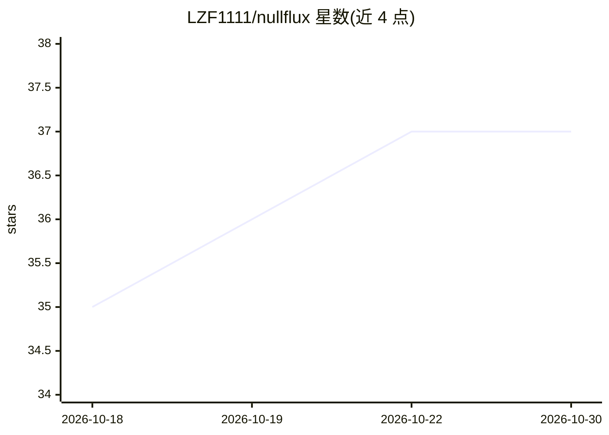

# LZF1111/nullflux

⭐ 37 · JavaScript · 推送 2026-06-10 · [GitHub](https://github.com/LZF1111/nullflux) · [官网](https://lzf1111.github.io/nullflux/) · 个人维护 · 中文 README

**本地部署的中文 CFD 仿真智能体，对话驱动 OpenFOAM 全流程**

面向 CFD/数值仿真科研工作者的 Linux 本地 AI Agent：通过多轮对话驱动 OpenFOAM 建模、网格生成、求解器运行、残差诊断与 ParaView 渲染，内置项目记忆、工具调用审批与工作目录沙箱；可自动编写并编译自定义求解器/边界条件/湍流模型。支持接入 DeepSeek、OpenAI 兼容端点及局域网 vLLM/Ollama。以封装发行版 tar.gz 形式提供，零 npm 依赖，需 Node 18+，OpenFOAM/ParaView/Python 为可选组件；发行版限评估与内部部署，禁止反混淆与商用转售。

## 筛选速览

| 维度 | 判定 | 备注 |
|---|---|---|
| AI 角色 | `ai-native` | 本体是模型或模型工具 |
| 许可风险 | `none` | — |
| 部署形态 | `library` | 以包/库形式分发 |
| 模型依赖 | local-ok | 支持本地模型 |
| 硬件要求 | `cpu-ok` | |
| 安装摩擦 | `low` | 无编译、无系统依赖或容器化 |
| 成熟度 | — | 结构信号不足 |

## 能力要点

- 专用工具 openfoam_run/openfoam_log 自动 source 环境，网格工具链 blockMesh→snappyHexMesh→checkMesh 一条龙
- 可生成自定义求解器/边界条件/湍流模型并自动 wmake 编译、失败自动诊断重编
- pvpython 离屏渲染将残差曲线/流线图直接贴回对话
- 工作目录长期记忆库，算例经验本地存储不上云

## 适用场景

- 用中文对话跑通 OpenFOAM 圆柱绕流等算例并查看残差诊断
- 读论文后让 Agent 编写并编译新算法求解器
- 内网工作站/HPC 登录节点上离线配合局域网 LLM 使用

## 场景标签

`科研工具` `编码 Agent` `Agent 记忆` · 领域:Agent 开发

## 证据(README 行号)

> L20: **CFDriver** 是一个**本地部署、原生中文**的 AI Agent，专为 **CFD / 数值仿真 / 科学计算**场景设计。
> L32: - **DeepSeek-V3 / Qwen3 / GLM-4.6 / Kimi-K2 等国产模型，在 CFD 任务上的成功率显著高于 Claude Code 调通用模型**

## 星数曲线

2026-10-18 35 → 2026-10-30 37（+2）

---
*卡片 v1 · prompt 1.4 · 生成 2026-10-25 · 置信度 mid · 依据 README sha `054c5c595773` · [字段定义](../../DATASET.md)*
