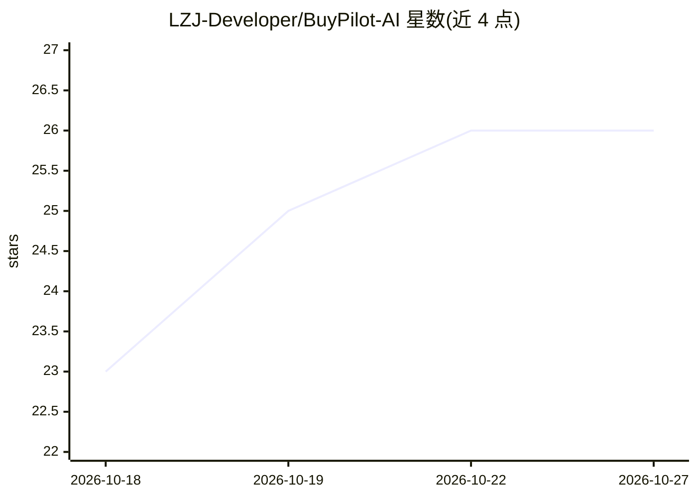

# LZJ-Developer/BuyPilot-AI

⭐ 26 · Kotlin · 推送 2026-06-17 · [GitHub](https://github.com/LZJ-Developer/BuyPilot-AI) · 组织维护 · 中文 README

**多模态电商导购 Agent：把模糊购物需求转为可解释的推荐决策**

ByteDance AI Challenge 参赛项目，面向终端购物用户的对话式导购系统：Android 原生客户端（Kotlin + Jetpack Compose）+ Python FastAPI 后端 + PostgreSQL/pgvector。核心链路为意图识别→购买标准生成→BM25+向量+RRF 混合检索→商品推荐→证据绑定，支持拍照找货（Qwen-VL 图像理解+双通道检索）、多轮约束排除、多商品对比与自然语言购物车。LLM 采用百炼 Qwen 系列（Qwen-Turbo/Qwen-VL-Plus），需配置 BAILIAN_API_KEY 与云端 API；提供预编译 APK（6.6MB，内置云端后端）或 Docker 本地部署。README 附 20 样本×15 指标的评测数据（综合分 78.4%）。

## 筛选速览

| 维度 | 判定 | 备注 |
|---|---|---|
| AI 角色 | `ai-native` | 本体是模型或模型工具 |
| 许可风险 | `none` | — |
| 部署形态 | `None` |  |
| 模型依赖 | — | README 未给出锁定关系 |
| 硬件要求 | — | 无带数字的原话,不猜 |
| 安装摩擦 | `low` | 无编译、无系统依赖或容器化 |
| 成熟度 | — | 结构信号不足 |

## 能力要点

- 文本+图像 1024 维同向量空间的双通道检索
- 推荐理由绑定原始知识库证据，GroundingGuard 价格校验
- SSE 10 种事件类型的三端协议守卫
- 决策评分算法：5 因子加权，LLM 只解释不挑选

## 适用场景

- 对话式说出模糊需求获得带证据的商品推荐
- 拍照上传商品图找相似货并询问适配性
- 多轮补充和排除条件收敛购物决策
- 自然语言管理购物车

## 场景标签

`RAG` `多模态` `推荐系统` · 领域:知识与检索

## 证据(README 行号)

> L5:  多模态电商导购 Agent：把模糊的购物需求转化为可解释的决策路径。
> L120: |LLM|**百炼主力 + Doubao 兜底**：Qwen-Turbo 做意图/标准/推荐/决策主力；Qwen-VL-Plus 做图片理解|
> L156: |模糊推荐 + 条件筛选|✅|意图识别 → 标准生成 → 混合检索 → 商品推荐 → 证据绑定|

## 星数曲线

2026-10-18 23 → 2026-10-27 26（+3）

---
*卡片 v1 · prompt 1.4 · 生成 2026-10-26 · 置信度 high · 依据 README sha `6284998d23b8` · [字段定义](../../DATASET.md)*
