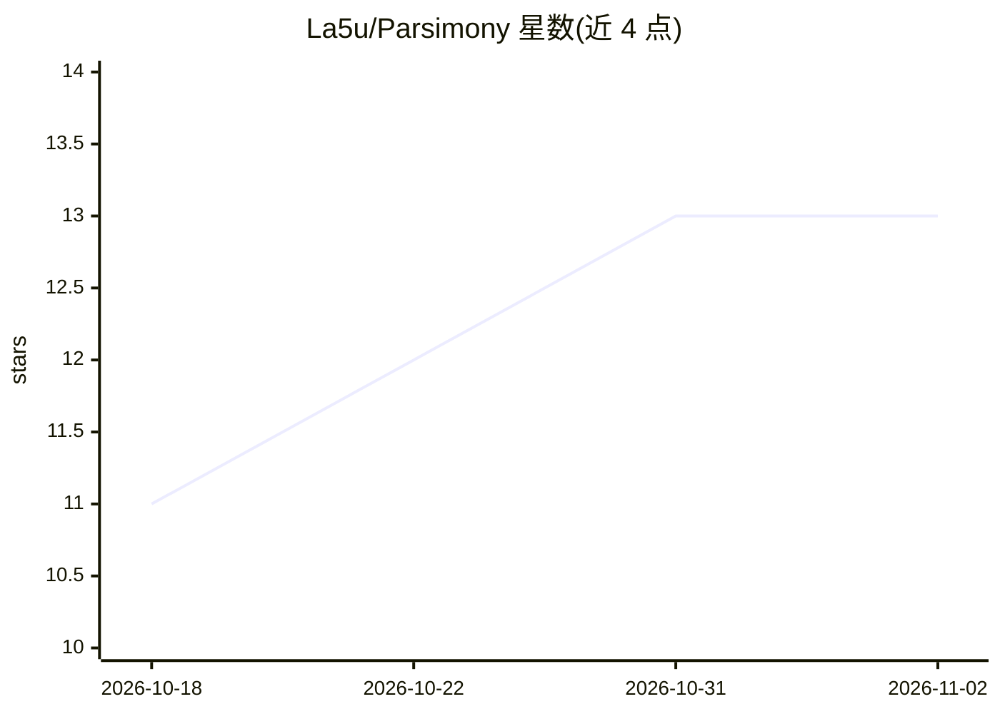

# La5u/Parsimony

⭐ 13 · Python · MIT · 推送 2026-10-27 · [GitHub](https://github.com/La5u/Parsimony) · [官网](parsimony.lasu.dev) · 个人维护

**度量 AI 编码 agent 在公开基准补丁中增删代码量的分析工具**

解析 DeepSWE、SWE-bench Verified、SWE-bench Live 等公开基准已发布的补丁，按语法元素（coding unit）统计各模型在每个任务上新增与删除的代码量，不运行任何代码，全部数字可从公开数据复算。每个基准与语言有独立排行榜，按同任务相对比值排序，另提供 Python 库 measure 函数、CLI 命令与站点重建脚本。数据按每模型 JSONL 存放，附带产物哈希与冻结任务集；README 列明小改动未必更优、缺失尝试可能引入偏差等限制。需要 Python 3.12+，Python 分析器无依赖。

## 筛选速览

| 维度 | 判定 | 备注 |
|---|---|---|
| AI 角色 | `ai-ecosystem` | LLM/agent 周边工具 |
| 许可风险 | `permissive` | MIT |
| 部署形态 | `library` | 以包/库形式分发 |
| 模型依赖 | — | README 未给出锁定关系 |
| 硬件要求 | — | 无带数字的原话,不猜 |
| 安装摩擦 | `low` | 无编译、无系统依赖或容器化 |
| 成熟度 | — | 结构信号不足 |

## 能力要点

- 以语法单元（语句/调用/比较/名字/字面量）统计补丁增删代码量
- 覆盖 DeepSWE、SWE-bench Verified/Live、SWEeper、PolyBench 等 12 个榜单
- 同任务相对比值排序，支持开源/闭源模型过滤与双模型对比视图
- 不运行代码，所有数字可从公开数据复算

## 适用场景

- 比较各 AI 编码模型解决同一任务时写入了多少代码
- 自行测量已发布的 SWE-bench 提交补丁
- 查看各基准任务的典型已解决补丁与复杂度变化

## 场景标签

`模型评测` · 领域:评测与运维

## 证据(README 行号)

> L5: Parsimony takes the patches that agents published for public benchmarks (DeepSWE, SWE-bench Verified, SWE-bench Live
> L11: Some tasks need far more code than others, and each model solves a different set. So each model is ranked by **the 

## 星数曲线

2026-10-18 11 → 2026-11-02 13（+2）

---
*卡片 v1 · prompt 1.4 · 生成 2026-10-31 · 置信度 mid · 依据 README sha `0d6441573e24` · [字段定义](../../DATASET.md)*
