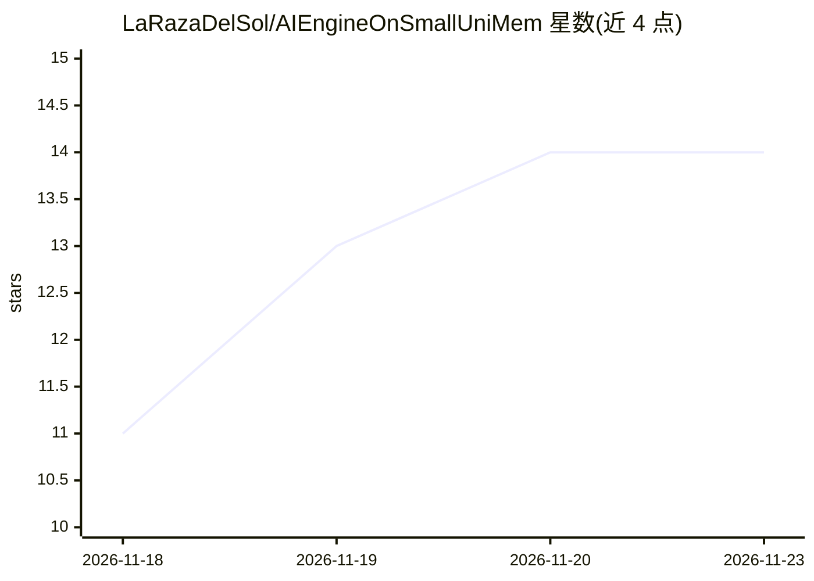

# LaRazaDelSol/AIEngineOnSmallUniMem

⭐ 14 · Python · MIT · 推送 2026-11-16 · [GitHub](https://github.com/LaRazaDelSol/AIEngineOnSmallUniMem) · 个人维护

**在 PS5 Linux 上以流式方式运行 125B MoE 大模型的推理引擎**

用 C++20 与 GLSL 针对 PS5（Linux）单一硬件从零编写的流式推理引擎：利用 16 GB 统一内存、Vulkan 计算访问主机 GPU，并通过 io_uring/O_DIRECT 与 dma-buf 把 24,576 个专家从 M.2 SSD 零拷贝流入槽池。支持 262k 上下文、OpenAI/Anthropic 兼容 HTTP API（流式、工具调用）及仪表盘，提供 systemd 开机自启与无主机冒烟测试。限制：仅适配 PS5 固件 13.00 与特定内核，需已能引导 Linux 的主机，不含越狱说明。

## 筛选速览

| 维度 | 判定 | 备注 |
|---|---|---|
| AI 角色 | `ai-ecosystem` | LLM/agent 周边工具 |
| 许可风险 | `permissive` | MIT |
| 部署形态 | `None` |  |
| 模型依赖 | — | README 未给出锁定关系 |
| 硬件要求 | — | 无带数字的原话,不猜 |
| 安装摩擦 | `medium` | 含编译或系统依赖之一 |
| 成熟度 | — | 结构信号不足 |

## 能力要点

- EXL3 量化专家（2.68-3.18 bpw）+ 零拷贝 SSD 流式加载，约 12 GiB 专家池
- _decode 49-57 tok/s、262k 上下文、SSD 上恢复 12 万 token 对话约 1 s
- OpenAI/Anthropic 兼容 API（:8081）与仪表盘/聊天（:8080）
- 路由预测与 MTP 投机解码、cache-aware routing

## 适用场景

- 在没有传统独立显卡的 PS5 主机上本地运行大模型推理
- 为兼容 OpenAI/Anthropic 协议的客户端提供本地推理服务端
- 研究小内存统一内存架构下的专家流式推理方案

## 场景标签

`推理引擎` `模型量化` · 领域:训练与推理

## 证据(README 行号)

> L3: A streaming inference engine that runs **Qwen3.8-Flash-Next**, a 125B-parameter mixture-of-experts model, on a
> L22: |API|OpenAI- and Anthropic-compatible HTTP API on `:8081` (streaming, tool calls, thinking); dashboard and chat on 

## 星数曲线

2026-11-18 11 → 2026-11-23 14（+3）

---
*卡片 v1 · prompt 1.4 · 生成 2026-11-19 · 置信度 high · 依据 README sha `ba7340fda910` · [字段定义](../../DATASET.md)*
