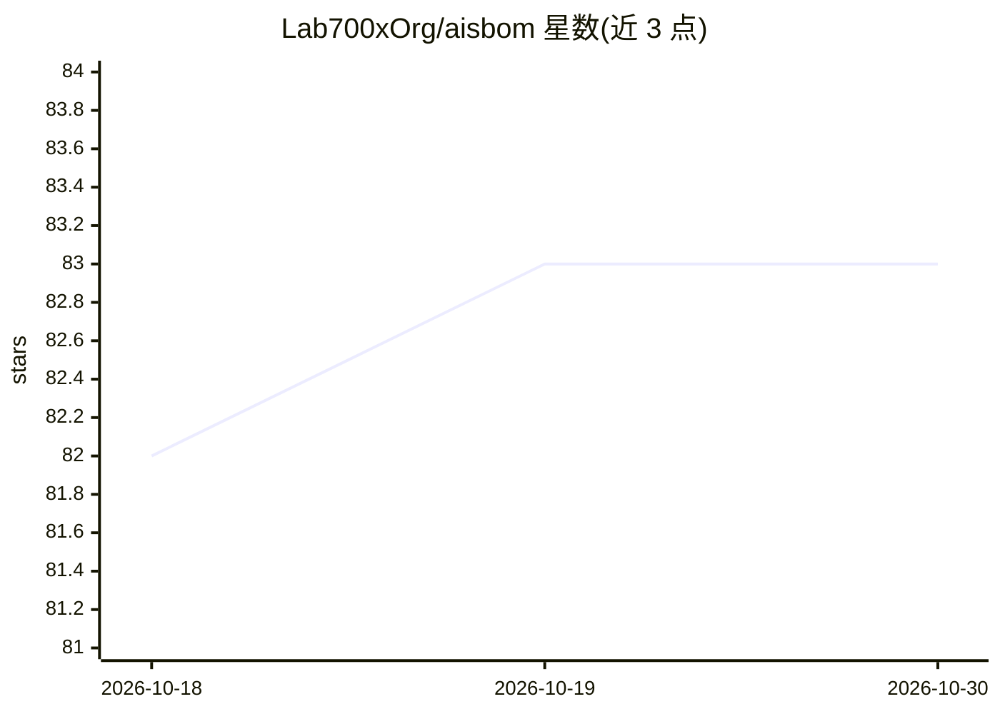

# Lab700xOrg/aisbom

⭐ 83 · Python · Apache-2.0 · 推送 2026-10-25 · [GitHub](https://github.com/Lab700xOrg/aisbom) · [官网](https://www.aisbom.io/) · 组织维护

**ML 模型文件静态安全扫描器，生成 AIBOM 合规证据**

面向需要在加载前审计模型文件的开发者与安全/合规团队：静态反汇编 Pickle 字节码、检查 Keras Lambda 层、解析 GGUF chat template 的 Jinja 沙箱逃逸、遍历 ONNX 图与 SafeTensors 头，输出安全与许可风险表，并生成 CycloneDX 1.7 / SPDX 的 AI-BOM 作为 EU AI Act、CRA、FDA §524B 证据。全程不加载模型、不执行载荷。支持扫描本地目录、单文件、hf:// 仓库（HTTP Range 只读头部）与 HTTPS URL；另提供 GitHub Action、独立二进制、两次扫描间的 diff 与 weights_only 迁移检查。限制：无法解析的文件不给出风险判定并使退出码为 1；--share 会将 SBOM 上传至 aisbom.io 托管 30 天。

## 筛选速览

| 维度 | 判定 | 备注 |
|---|---|---|
| AI 角色 | `ai-ecosystem` | LLM/agent 周边工具 |
| 许可风险 | `permissive` | Apache-2.0 |
| 部署形态 | `desktop` | 安装包/桌面程序 |
| 模型依赖 | — | README 未给出锁定关系 |
| 硬件要求 | — | 无带数字的原话,不猜 |
| 安装摩擦 | `low` | 无编译、无系统依赖或容器化 |
| 成熟度 | — | 结构信号不足 |

## 能力要点

- 支持 PyTorch/joblib/dill/NumPy/Keras/GGUF/ONNX/SafeTensors 等格式的静态风险检测
- 生成 CycloneDX v1.7 / SPDX 2.3-3.0 的 AI-BOM（含 SHA256 与许可数据）
- hf:// 扫描用 HTTP Range 仅读取头部，不下载权重
- 提供 GitHub Action、独立二进制（Linux/macOS）与 pipx/pip 安装

## 适用场景

- 在加载第三方模型前检查 pickle 炸弹与 RCE 载荷
- 为 EU AI Act / CRA / FDA §524B 合规生成 AI-BOM 证据
- CI 中对比两次扫描、检测组件风险升级或文件哈希变化

## 场景标签

`网络安全` · 领域:学习与行业

## 证据(README 行号)

> L12: AIsbom disassembles Pickle bytecode, inspects Keras configs for code-executing `Lambda` layers, reads GGUF chat tem
> L50: A compliant `sbom.json` (CycloneDX v1.7 / ECMA-424) including SHA256 hashes and license data is generated in your w
> L105: |Exit|Meaning|

## 星数曲线

2026-10-18 82 → 2026-10-30 83（+1）

---
*卡片 v1 · prompt 1.4 · 生成 2026-10-24 · 置信度 high · 依据 README sha `5c1d9a965eb8` · [字段定义](../../DATASET.md)*
