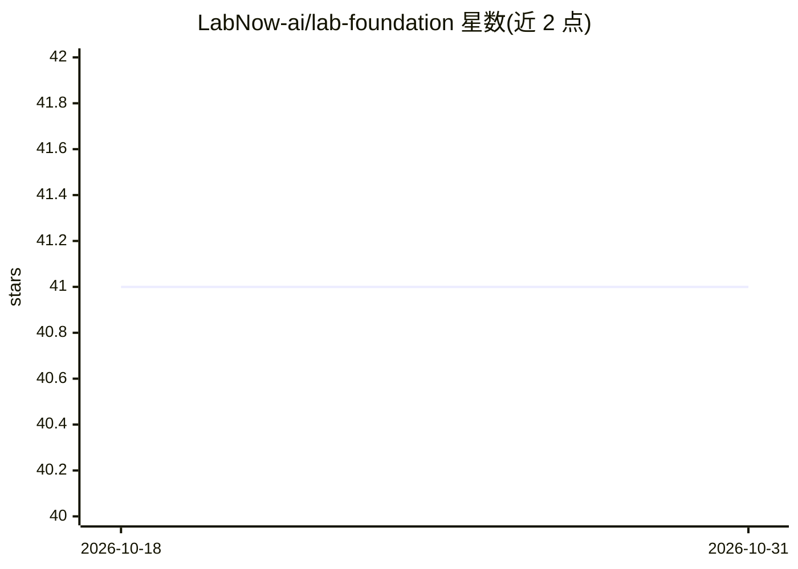

# LabNow-ai/lab-foundation

⭐ 41 · Shell · BSD-3-Clause · 推送 2026-10-27 · [GitHub](https://github.com/LabNow-ai/lab-foundation) · [官网](https://labnow.ai) · 组织维护 · 中文 README

**开箱即用的数据科学与 AI 容器环境镜像栈**

Lab Foundation 是 LabNow 提供的容器镜像栈，通过 Quay.io 与 DockerHub 分发预置数据科学与 AI 工具的环境镜像，覆盖 Python、R、Julia、Go 等语言与机器学习、NVIDIA GPU 相关主题。面向希望快速获得可用分析环境的开发者和科研用户，拉取镜像即可运行，无需自行搭建依赖。README 提供英文与中文文档入口，中文指引包含中国网络镜像配置。仓库徽章显示许可证与持续构建状态，具体包含的工具清单需查阅 Wiki 文档。

## 筛选速览

| 维度 | 判定 | 备注 |
|---|---|---|
| AI 角色 | `ai-ecosystem` | LLM/agent 周边工具 |
| 许可风险 | `permissive` | BSD-3-Clause |
| 部署形态 | `None` |  |
| 模型依赖 | — | README 未给出锁定关系 |
| 硬件要求 | — | 无带数字的原话,不猜 |
| 安装摩擦 | `low` | 无编译、无系统依赖或容器化 |
| 成熟度 | — | 结构信号不足 |

## 能力要点

- 以容器镜像形式分发预置的数据科学/AI 环境
- 镜像同时发布于 Quay.io 与 DockerHub
- 主题覆盖 Python/R/Julia/Go 与 NVIDIA GPU 支持
- 提供中文使用指引（含中国网络镜像配置）

## 适用场景

- 通过拉取镜像快速获得数据科学/AI 开发环境
- 在 GPU 环境中运行机器学习工作流
- 国内网络环境下使用镜像加速配置环境

## 场景标签

 · 领域:数据科学/AI 开发环境

## 证据(README 行号)

> L17: In a nutshell, `LabNow` (
> L21: ) brings **out-of-box Data Science / AI environments and platform** to your fingertip to make data science accessib

## 星数曲线

2026-10-18 41 → 2026-10-31 41（+0）

---
*卡片 v1 · prompt 1.4 · 生成 2026-10-25 · 置信度 mid · 依据 README sha `b66595bd2c22` · [字段定义](../../DATASET.md)*
