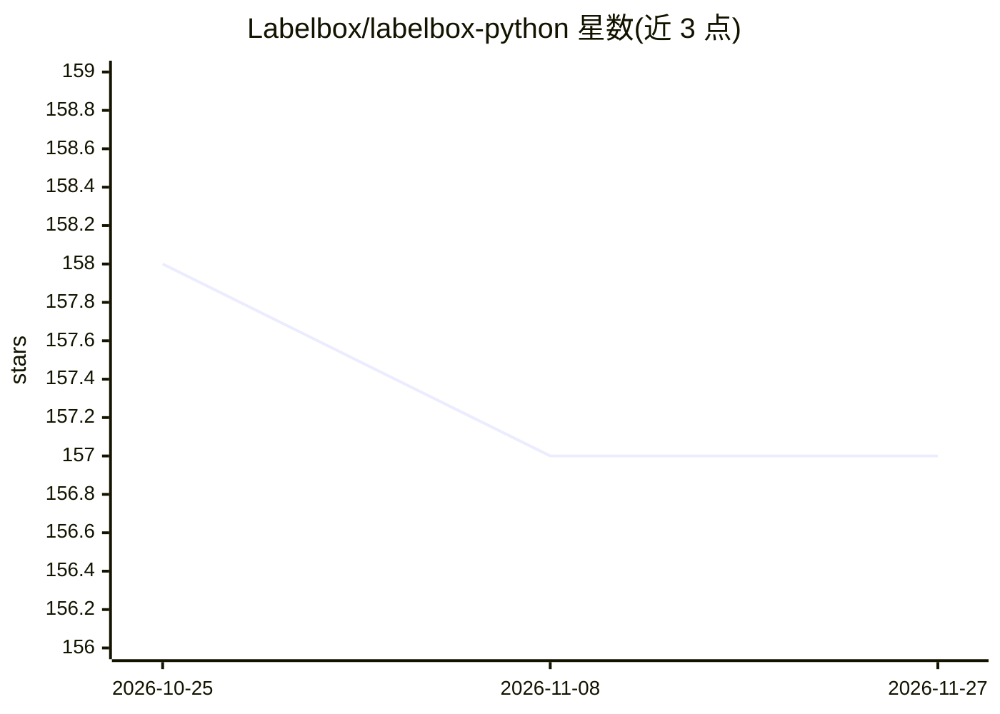

# Labelbox/labelbox-python

⭐ 157 · Python · Apache-2.0 · 推送 2026-11-25 · [GitHub](https://github.com/Labelbox/labelbox-python) · [官网](https://labelbox.com) · 组织维护

**Labelbox 平台的 Python SDK：供企业做数据标注与模型评估**

Labelbox 官方 Python SDK，通过 API key 连接 Labelbox 平台，支持数据整理（curate）、标注、生成人工反馈数据（覆盖计算机视觉与语言模型）、模型性能评估，以及 AI 与人工流程结合的任务自动化。通过 pip 安装，可选 labelbox[data] 附加数据处理能力；仓库提供 Jupyter Notebook 示例与官方文档。每个发布版本附带 SLSA Level 3 构建溯源与 PyPI attestation，供验证包未被篡改。维护者为 Labelbox 公司，代码 Apache 2.0 许可。

## 筛选速览

| 维度 | 判定 | 备注 |
|---|---|---|
| AI 角色 | `ai-ecosystem` | LLM/agent 周边工具 |
| 许可风险 | `permissive` | Apache-2.0 |
| 部署形态 | `library` | 以包/库形式分发 |
| 模型依赖 | — | README 未给出锁定关系 |
| 硬件要求 | — | 无带数字的原话,不猜 |
| 安装摩擦 | `low` | 无编译、无系统依赖或容器化 |
| 成熟度 | — | 结构信号不足 |

## 能力要点

- pip 安装，可选 labelbox[data] 扩展数据处理能力
- 支持数据整理、标注与人工反馈数据生成（CV 与语言模型）
- 每个 release 附带 SLSA 3 溯源文档与 PyPI attestation
- examples 目录提供 Jupyter Notebook 示例

## 适用场景

- 为视觉或语言模型整理和标注训练数据
- 生成高质量人工反馈数据
- 评估并改进模型性能
- 科研社区用于 AI 实验数据处理

## 场景标签

`MLOps` · 领域:训练与推理

## 证据(README 行号)

> L14: With Labelbox, enterprises can easily curate and annotate data, generate high-quality human feedback data for compu
> L30: To install the SDK, run the following command.

## 星数曲线

2026-10-25 158 → 2026-11-27 157（-1）

---
*卡片 v1 · prompt 1.4 · 生成 2026-11-27 · 置信度 high · 依据 README sha `2d4cc8c9ed1a` · [字段定义](../../DATASET.md)*
