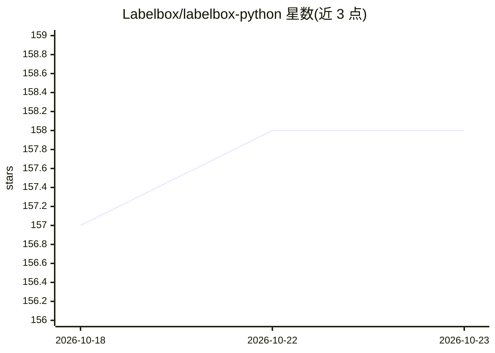

# Labelbox/labelbox-python

⭐ 158 · Python · Apache-2.0 · 推送 2026-10-22 · [GitHub](https://github.com/Labelbox/labelbox-python) · [官网](https://labelbox.com) · 组织维护

**Labelbox 平台的 Python SDK：数据标注与模型评估编程接入**

Labelbox 官方 Python SDK，用于以编程方式访问 Labelbox 数据管理与标注平台：创建数据集、管理数据行、生成人类反馈数据、评估模型表现并自动化 AI 与人工工作流。用户需在 labelbox.com 注册账号并生成 API Key 后使用。提供两种 pip 安装方式（基础版与含数据处理扩展的 labelbox[data]），附带 Jupyter Notebook 示例与 SDK 参考文档；自 v3.72.2 起每个发布附带 SLSA Level 3 来源证明文档。SDK 本身不执行模型推理。

## 筛选速览

| 维度 | 判定 | 备注 |
|---|---|---|
| AI 角色 | `ai-ecosystem` | LLM/agent 周边工具 |
| 许可风险 | `permissive` | Apache-2.0 |
| 部署形态 | `library` | 以包/库形式分发 |
| 模型依赖 | — | README 未给出锁定关系 |
| 硬件要求 | — | 无带数字的原话,不猜 |
| 安装摩擦 | `low` | 无编译、无系统依赖或容器化 |
| 成熟度 | — | 结构信号不足 |

## 能力要点

- 通过 API Key 以编程方式操作 Labelbox 数据集与标注数据
- 可选 labelbox[data] 安装提供数据处理扩展能力
- 发布附带 SLSA Level 3 Provenance 文档可验证供应链来源
- examples 目录提供 Jupyter Notebook 示例

## 适用场景

- 在企业数据管线中批量创建与管理标注数据集
- 为视觉与语言模型生成人类反馈数据
- 程序化评估与改进模型表现

## 场景标签

`MLOps` `模型评测` · 领域:评测与运维

## 证据(README 行号)

> L14: With Labelbox, enterprises can easily curate and annotate data, generate high-quality human feedback data for compu
> L33: pip install labelbox

## 星数曲线

2026-10-18 157 → 2026-10-23 158（+1）

---
*卡片 v1 · prompt 1.4 · 生成 2026-10-22 · 置信度 high · 依据 README sha `506820c60705` · [字段定义](../../DATASET.md)*
