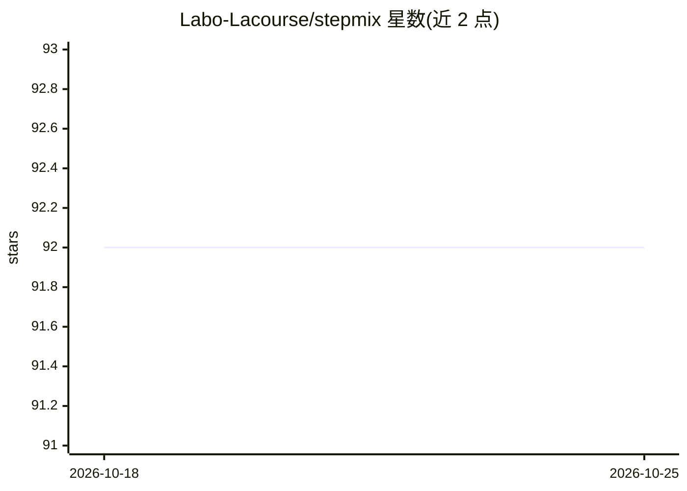

# Labo-Lacourse/stepmix

⭐ 92 · Python · MIT · 推送 2026-05-04 · [GitHub](https://github.com/Labo-Lacourse/stepmix) · [官网](https://stepmix.readthedocs.io/en/latest/index.html) · 组织维护

**基于伪似然的广义混合模型 Python 库：潜类别/潜剖面分析与聚类**

遵循 scikit-learn API 的 Python 包，用于广义混合建模：支持分类数据（潜类别分析 LCA）、连续数据（高斯混合/潜剖面分析）及二者混合，可用于聚类与（半）监督学习。机制上提供 FIML 缺失值处理、多种基于伪似然理论的分步 EM 估计（1/2/3 步，含 BCH/ML 校正）、协变量与结果变量、参数与非参数自助法及置信区间。接受 numpy 数组或 pandas DataFrame 输入，类别需整数 0 起编码。通过 pip 安装，配有 Jupyter notebook 教程。

## 筛选速览

| 维度 | 判定 | 备注 |
|---|---|---|
| AI 角色 | `ai-native` | 本体是模型或模型工具 |
| 许可风险 | `permissive` | MIT |
| 部署形态 | `library` | 以包/库形式分发 |
| 模型依赖 | — | README 未给出锁定关系 |
| 硬件要求 | — | 无带数字的原话,不猜 |
| 安装摩擦 | `low` | 无编译、无系统依赖或容器化 |
| 成熟度 | — | 结构信号不足 |

## 能力要点

- 分步 EM 估计（1/2/3 步）与 BCH/ML 校正
- FIML 全信息最大似然处理缺失值
- 分类数据 LCA 与连续数据高斯混合可组合建模
- 参数/非参数自助法、BLRT 与 AIC/BIC 等模型选择

## 适用场景

- 社会科学或生物医学数据中做潜类别/潜剖面分析
- 含缺失值的调查数据聚类并纳入协变量
- 用交叉验证或 BLRT 选择混合模型的成分数

## 场景标签

 · 领域:统计机器学习/社会科学方法

## 证据(README 行号)

> L13: A Python package following the scikit-learn API for generalized mixture modeling. The package supports categorical
> L14: data (Latent Class Analysis) and continuous data (Gaussian Mixtures/Latent Profile Analysis). StepMix can be used f
> L19: * Multiple stepwise Expectation-Maximization (EM) estimation methods based on pseudolikelihood theory;

## 星数曲线

2026-10-18 92 → 2026-10-25 92（+0）

---
*卡片 v1 · prompt 1.4 · 生成 2026-10-23 · 置信度 high · 依据 README sha `0728634f8db2` · [字段定义](../../DATASET.md)*
