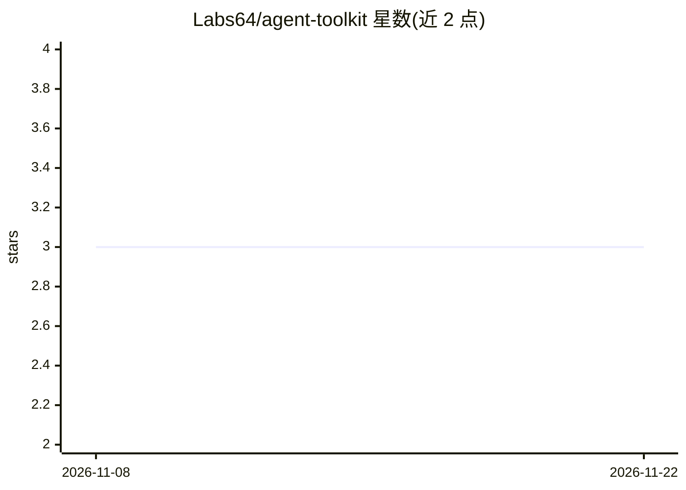

# Labs64/agent-toolkit

⭐ 3 · HTML · Apache-2.0 · 推送 2026-11-19 · [GitHub](https://github.com/Labs64/agent-toolkit) · 组织维护

**为 AI 编码 agent 提供 Claude Code 插件形式的开发技能包**

Labs64 发布的编码 agent 工具集，以 Claude Code 插件形式分发，labs64-dev 插件内含分支/PR 审查与问题跟踪、合并请求标题与描述起草等技能。技能遵循 Agent Skills 开放格式，其他读取该格式的 agent 可通过复制或链接技能目录使用。通过 Claude Code 插件市场安装，支持命令更新与自动更新；原 review 与 writing 插件已合并为 labs64-dev，需替换安装。Apache-2.0 许可。

## 筛选速览

| 维度 | 判定 | 备注 |
|---|---|---|
| AI 角色 | `ai-ecosystem` | LLM/agent 周边工具 |
| 许可风险 | `permissive` | Apache-2.0 |
| 部署形态 | `None` |  |
| 模型依赖 | — | README 未给出锁定关系 |
| 硬件要求 | — | 无带数字的原话,不猜 |
| 安装摩擦 | `low` | 无编译、无系统依赖或容器化 |
| 成熟度 | — | 结构信号不足 |

## 能力要点

- labs64-dev 插件含 branch-review-tracker 与 mr-description 技能
- 技能遵循 Agent Skills 开放格式，非 Claude Code 的 agent 也可使用
- 提供插件市场安装、更新与自动更新流程

## 适用场景

- 让编码 agent 审查分支或 PR 并跟踪修复轮次中的问题
- 让 agent 起草合并请求标题与描述
- 在其他支持 Agent Skills 格式的 agent 中复用这些技能

## 场景标签

`编码 Agent` `代码审查` · 领域:编码与开发

## 证据(README 行号)

> L3: Tools for coding agents from Labs64.
> L12: The skills follow the Agent Skills format, so agents
> L13: other than Claude Code can use them too.

## 星数曲线

2026-11-08 3 → 2026-11-22 3（+0）

---
*卡片 v1 · prompt 1.4 · 生成 2026-11-22 · 置信度 high · 依据 README sha `0fb1cac7ed3a` · [字段定义](../../DATASET.md)*
