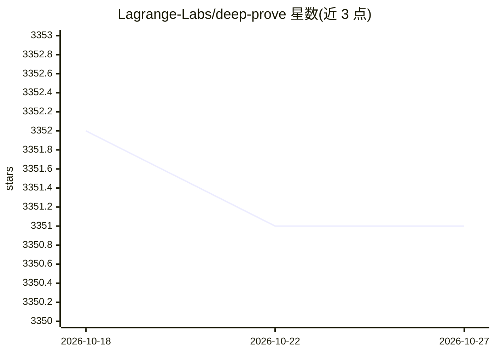

# Lagrange-Labs/deep-prove

⭐ 3,351 · Rust · NOASSERTION · 推送 2026-05-31 · [GitHub](https://github.com/Lagrange-Labs/deep-prove) · [官网](https://lagrange.dev) · 组织维护

**为神经网络/LLM 推理生成零知识证明的 Rust 框架**

Rust workspace 形式的 ZKML 框架：对神经网络前向推理（GPT-2、Gemma 3、Llama 2 的全部 transformer 层，以及 MLP/CNN）生成密码学证明并验证，采用 sumcheck 与 logup GKR，证明时间随模型规模亚线性。核心 zkml 库负责量化、层实现与证明生成；另有 worker 证明服务器、CLI 提交作业、tenstore 张量存储（支持本地与 S3 兼容后端）及调试工具。安装与 GPU 构建步骤位于 zkml/README.md。采用 Lagrange License，基于 scroll-tech/ceno 的 sumcheck/GKR 实现。

## 筛选速览

| 维度 | 判定 | 备注 |
|---|---|---|
| AI 角色 | `ai-ecosystem` | LLM/agent 周边工具 |
| 许可风险 | `none` | NOASSERTION |
| 部署形态 | `None` |  |
| 模型依赖 | — | README 未给出锁定关系 |
| 硬件要求 | — | 无带数字的原话,不猜 |
| 安装摩擦 | `low` | 无编译、无系统依赖或容器化 |
| 成熟度 | — | 结构信号不足 |

## 能力要点

- 端到端证明完整 transformer 推理：从 token 嵌入到 next-token argmax
- GPT-2 512 tokens 单机证明 7.6 分钟，验证 1.3 秒，证明 10.7 MiB
- 12-bit 量化下与浮点基线保持 ≥99.6% 余弦相似度
- 支持水平证明分发与 GPU 加速，GPU 集群在路线图中

## 适用场景

- 为 LLM/ML 推理结果生成可验证的密码学证明
- 在链下推理场景中向第三方证明模型输出确实由指定模型产生
- 量化模型推理的证明生成服务器与远程证明网络部署

## 场景标签

 · 领域:密码学/可验证机器学习

## 证据(README 行号)

> L3: Zero-knowledge proof system for neural network inference, with first-class support for end-to-end LLM proving.
> L11: DeepProve is the first end-to-end zero-knowledge proof system for full LLM inference. It generates cryptographic pr
> L13: Confirmed working models: **GPT-2**, **Gemma 3**, **Llama 2** — all transformer layers proven end-to-end, from toke

## 星数曲线

2026-10-18 3,352 → 2026-10-27 3,351（-1）

---
*卡片 v1 · prompt 1.4 · 生成 2026-10-20 · 置信度 high · 依据 README sha `8430bc6fe6c9` · [字段定义](../../DATASET.md)*
